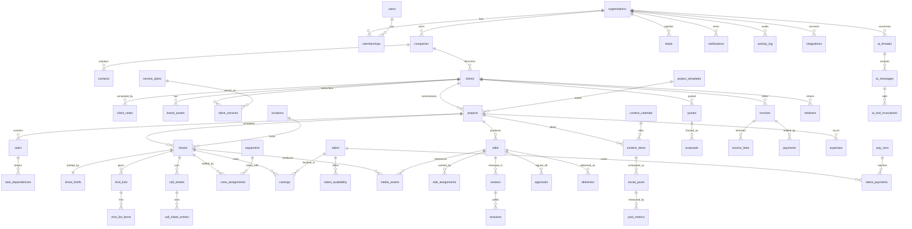

# Blanc Script OS — Database Schema

**Status:** Planned (v0). Nothing in this document is implemented yet.
**Owner:** Backend & Database Architect. This is the **authoritative data model** for Blanc Script OS. All other agents consume the table and column names defined here.
**Database:** Neon (serverless Postgres) · **ORM:** Drizzle + Drizzle Kit · **Isolation:** Postgres Row-Level Security (RLS) via Neon Authorize reading Clerk JWTs.
**Conventions (locked by `_FOUNDATION.md`):** `snake_case` identifiers · UUID PKs (`gen_random_uuid()`) · money as integer **pence** + ISO currency · all times `timestamptz` (UTC) · soft-delete via `archived_at` · every tenant table carries `org_id uuid not null` + `created_at`/`updated_at` + RLS. British English, UK VAT aware throughout.

> **Design thesis — relational, not a `records` table.** Centauri's public bundle funnels ~130 object "kinds" through a single `records` row-store (see `docs/centauri-crm-analysis.md` §3.3). That is fast to ship and miserable to query, constrain, index and secure. Blanc Script OS goes **one table per entity** with real foreign keys, typed enums, partial indexes and per-table RLS. We get referential integrity, cheap joins, honest constraints, and policies that a human can read.

---

## 1. Conventions & shared building blocks

### 1.1 Column conventions
Every **tenant-scoped** (business) table includes:

| Column | Type | Notes |
|---|---|---|
| `id` | `uuid` PK | `default gen_random_uuid()` |
| `org_id` | `uuid not null` | FK → `organisations(id)`; RLS tenant key |
| `created_at` | `timestamptz not null` | `default now()` |
| `updated_at` | `timestamptz not null` | `default now()`; bumped by trigger `set_updated_at()` |
| `created_by` | `uuid null` | FK → `users(id)` (actor at creation; null for system/sync writes) |
| `archived_at` | `timestamptz null` | soft-delete; `null` = live. Hard delete only via GDPR erasure path |

For brevity the per-table column lists below **omit these six** unless a table deviates (e.g. global/non-tenant tables `organisations`, `users`). Assume all six are present on every business table.

### 1.2 Money & tax
- Money is **two columns**: `*_pence integer` (minor units, signed where refunds/credits apply) + `currency char(3) not null default 'GBP'` (ISO 4217).
- VAT: line-level `vat_rate_bps integer` (basis points, e.g. `2000` = 20.00%), `vat_treatment` enum, computed `vat_pence` and `gross_pence` stored at write time (never floats, never recomputed on read for historical rows).
- Never `numeric`/`float` for money. `numeric` is allowed only for non-money ratios (e.g. edit capacity).

### 1.3 Enums (Postgres `CREATE TYPE … AS ENUM`)
Enums are used where the value set is small, stable and drives logic. Volatile/extensible lists (platforms, integration providers) are `text` + `CHECK` or a lookup table so we can add values without a migration lock.

```
org_role            : owner | ops | account_manager | editor | filmer | client_user | talent_user
lead_stage          : new | contacted | qualified | proposal_sent | call_booked | won | lost
client_status       : prospect | active | paused | churned
project_status      : planning | active | on_hold | delivered | archived
task_status         : todo | in_progress | blocked | in_review | done | cancelled
task_priority       : low | normal | high | urgent
shoot_status        : enquiry | provisional | confirmed | on_site | wrapped | cancelled
edit_status         : queued | being_edited | revision_needed | sent_to_client | approved | ready_to_post | published
review_decision     : pending | changes_requested | approved
casting_status      : shortlisted | offered | confirmed | declined | turned_up | no_show
content_status      : idea | drafting | in_review | approved | scheduled | published | failed
post_platform       : tiktok | instagram | youtube | facebook | linkedin | x | google_business   (text+CHECK, extensible)
quote_status        : draft | sent | accepted | declined | expired
invoice_status      : draft | sent | part_paid | paid | overdue | void
payment_direction   : inbound | outbound
pay_run_status      : draft | approved | processing | paid | partially_paid | failed
vat_treatment       : standard | reduced | zero_rated | exempt | outside_scope | reverse_charge
integration_status  : disconnected | connected | error | expired | revoked
notification_channel: in_app | email | push
ai_thread_scope     : org | client | project | shoot | edit | invoice | freeform
ai_message_role     : user | assistant | tool | system
activity_action     : created | updated | archived | restored | status_changed | assigned | commented | paid | sent | login | permission_changed | ai_tool_invoked
```

### 1.4 RLS identity helpers (Neon Authorize + Clerk)
Clerk issues a JWT; Neon Authorize exposes its claims to Postgres. We wrap claim access in stable `SECURITY DEFINER` functions in an `app` schema so policies stay readable and the claim shape can change in one place.

```sql
-- Clerk user id (JWT 'sub', e.g. 'user_2abc…'); stored on users.clerk_user_id
create function app.clerk_user_id() returns text language sql stable as $$
  select nullif(current_setting('request.jwt.claims', true)::jsonb ->> 'sub', '');
$$;

-- Resolved internal users.id for the caller
create function app.current_user_id() returns uuid language sql stable as $$
  select u.id from users u where u.clerk_user_id = app.clerk_user_id();
$$;

-- Active org from Clerk 'org_id' claim (Clerk Organizations)
create function app.current_org_id() returns uuid language sql stable as $$
  select nullif(current_setting('request.jwt.claims', true)::jsonb ->> 'org_id','')::uuid;
$$;

-- The caller's membership row for the active org (role, capabilities, portal scope)
create function app.current_membership() returns memberships language sql stable as $$
  select m.* from memberships m
  where m.org_id = app.current_org_id()
    and m.user_id = app.current_user_id()
    and m.archived_at is null
  limit 1;
$$;

create function app.current_role() returns org_role language sql stable as $$
  select (app.current_membership()).role;
$$;

-- Capability check: role default OR explicit per-user override (see §3.2)
create function app.has_cap(cap text) returns boolean language sql stable as $$
  select coalesce((app.current_membership()).capabilities -> cap, 'false')::boolean;
$$;

create function app.is_internal() returns boolean language sql stable as $$
  select app.current_role() in ('owner','ops','account_manager','editor','filmer');
$$;

-- Portal scoping: a client_user is pinned to one client; a talent_user to one talent
create function app.current_client_id() returns uuid language sql stable as $$
  select (app.current_membership()).client_id;
$$;
create function app.current_talent_id() returns uuid language sql stable as $$
  select (app.current_membership()).talent_id;
$$;
```

### 1.5 RLS pattern (applied to every tenant table)
Two policy layers combine:

1. **Tenant gate (all tables):** `org_id = app.current_org_id()`. No row of another org is ever visible. The Postgres role used by the app is **non-superuser with `FORCE ROW LEVEL SECURITY`**, so even the app connection cannot bypass policies.
2. **Row/role gate (per table):** internal staff see org-wide data subject to capability flags; **`client_user` and `talent_user` see only rows reachable from their own `client_id`/`talent_id`** (reachability expressed as `EXISTS` joins to the owning record).

`archived_at is null` is **not** enforced in RLS (archived rows must remain visible to those who can restore them); it is a default filter in the data-access layer (§ MODULE_ARCHITECTURE) and in list queries.

Each table below states its policy in plain terms under **RLS**.

---

## 2. Entity-relationship overview



---

## 3. Tenancy, identity & permissions

### 3.1 `organisations` *(global — not org-scoped; it **is** the tenant)*
The agency tenant. In practice one row (Blanc Script) but modelled multi-tenant.

| Column | Type | Constraints |
|---|---|---|
| `id` | uuid PK | |
| `clerk_org_id` | text | unique not null (mirrors Clerk Organization) |
| `name` | text | not null |
| `slug` | text | unique not null |
| `default_currency` | char(3) | not null default `'GBP'` |
| `vat_number` | text | null (UK VAT reg no.) |
| `vat_registered` | boolean | not null default true |
| `company_registration_no` | text | null (Companies House) |
| `billing_address` | jsonb | null |
| `timezone` | text | not null default `'Europe/London'` |
| `settings` | jsonb | not null default `'{}'` (branding/skin, feature flags, posting defaults) |
| `created_at`/`updated_at`/`archived_at` | timestamptz | |

**Indexes:** unique `clerk_org_id`, unique `slug`.
**RLS:** select where `id = app.current_org_id()`. Insert/update/delete: platform/service-role only (org provisioning happens via Clerk webhook using the service connection, which is `BYPASSRLS`-exempt but runs as a dedicated migration/admin role). No end user mutates this directly except `owner`+`can_settings` for `name`/`settings`/VAT fields.

### 3.2 `users` *(global profiles, mirror of Clerk)*
One row per human (staff, client contact, talent) who can authenticate. Profile data only — **Clerk is the auth system of record**.

| Column | Type | Constraints |
|---|---|---|
| `id` | uuid PK | |
| `clerk_user_id` | text | unique not null |
| `email` | citext | not null |
| `full_name` | text | null |
| `avatar_url` | text | null |
| `phone` | text | null |
| `locale` | text | not null default `'en-GB'` |
| `last_seen_at` | timestamptz | null |
| `created_at`/`updated_at`/`archived_at` | | |

**Indexes:** unique `clerk_user_id`, unique `email`.
**RLS:** a user may `select`/`update` **their own** row (`clerk_user_id = app.clerk_user_id()`). Internal staff with `can_manage_users` may `select` any user who shares one of their orgs (via `memberships`). No hard delete except GDPR erasure. Users is global, so its policies key on membership overlap, not `org_id`.

### 3.3 `memberships` *(user ↔ org, with role, capabilities, portal scope)*
The join that makes everything multi-tenant and drives RLS. **This is where `client_user`/`talent_user` isolation is anchored.**

| Column | Type | Constraints |
|---|---|---|
| `id` | uuid PK | |
| `org_id` | uuid | not null FK → organisations |
| `user_id` | uuid | not null FK → users |
| `role` | `org_role` | not null |
| `capabilities` | jsonb | not null default `'{}'` — **effective overrides** merged over the role default set at write time; keys are capability names (§_FOUNDATION §3), values boolean |
| `client_id` | uuid | null FK → clients — **set iff role = client_user**; pins the portal user to one client |
| `talent_id` | uuid | null FK → talent — **set iff role = talent_user** |
| `invited_by` | uuid | null FK → users |
| `status` | text | not null default `'active'` CHECK in (`invited`,`active`,`suspended`) |
| `created_at`/`updated_at`/`archived_at` | | |

**Constraints:**
- unique `(org_id, user_id)`.
- CHECK: `role = 'client_user'` ⇒ `client_id is not null and talent_id is null`; `role = 'talent_user'` ⇒ `talent_id is not null and client_id is null`; internal roles ⇒ both null.
**Indexes:** unique `(org_id,user_id)`; `(org_id, role)`; partial `(client_id) where client_id is not null`; partial `(talent_id) where talent_id is not null`.
**RLS:** select — own membership always; internal staff with `can_manage_users` see all memberships in `current_org_id()`. Insert/update/delete — `owner`/`ops` with `can_manage_users` (capability changes are themselves audited and gated so a user cannot escalate their own role: a `CHECK`/trigger forbids editing your own `role`/`capabilities`). Portal users can read only their own membership row.

> **Capability model.** Roles map to a **default capability set** (defined in `USER_ROLES_AND_PERMISSIONS.md`, owned by Security). `memberships.capabilities` stores **only the effective resolved booleans** so RLS does a single JSONB lookup (`app.has_cap`) with no join. When an admin changes a role's defaults, a background job recomputes affected members' `capabilities`. This keeps policy evaluation O(1) and auditable.

---

## 4. CRM & Client Management

### 4.1 `companies`
Legal/brand entities we deal with (a client is a company we're engaged with; a lead may reference one).

| Column | Type | Constraints |
|---|---|---|
| `name` | text | not null |
| `website` | text | null |
| `industry` | text | null |
| `registration_no` | text | null |
| `address` | jsonb | null |
| `notes` | text | null |

**Indexes:** `(org_id, name)`; GIN trigram on `name` for search.
**RLS:** internal read/write (write needs `can_edit`). Portal users: a `client_user` may read the single company linked to their client; no write.

### 4.2 `contacts`
People at a company (main contact, finance contact, etc.).

| Column | Type | Constraints |
|---|---|---|
| `company_id` | uuid | not null FK → companies |
| `user_id` | uuid | null FK → users (set when the contact has a portal login) |
| `full_name` | text | not null |
| `email` | citext | null |
| `phone` | text | null |
| `role_title` | text | null |
| `is_primary` | boolean | not null default false |

**Indexes:** `(org_id, company_id)`; partial unique `(company_id) where is_primary` (one primary).
**RLS:** internal read/write. `client_user` reads contacts of their own company only.

### 4.3 `clients`
An active engagement with a company — the heart of CRM. Carries account manager, status, retainer link.

| Column | Type | Constraints |
|---|---|---|
| `company_id` | uuid | not null FK → companies |
| `account_manager_id` | uuid | null FK → users |
| `primary_contact_id` | uuid | null FK → contacts |
| `status` | `client_status` | not null default `'prospect'` |
| `onboarded_at` | timestamptz | null |
| `health` | text | null CHECK in (`green`,`amber`,`red`) |
| `tags` | text[] | not null default `'{}'` |
| `settings` | jsonb | not null default `'{}'` (posting days, delivery folder refs) |

**Indexes:** `(org_id, status)`; `(org_id, account_manager_id)`; unique `(org_id, company_id)`.
**RLS:** internal read; write needs `can_edit`; **delete/archive needs `can_archive` (owner/ops)**. `client_user` reads **only `id = app.current_client_id()`** — enforced on this table and inherited by every child via `EXISTS` joins.

### 4.4 `leads`
Sales pipeline, before/independent of an active client.

| Column | Type | Constraints |
|---|---|---|
| `company_id` | uuid | null FK → companies |
| `contact_name` | text | null |
| `contact_email` | citext | null |
| `source` | text | null |
| `stage` | `lead_stage` | not null default `'new'` |
| `owner_id` | uuid | null FK → users |
| `estimated_value_pence` | integer | null |
| `currency` | char(3) | not null default `'GBP'` |
| `expected_close` | date | null |
| `lost_reason` | text | null |
| `converted_client_id` | uuid | null FK → clients |

**Indexes:** `(org_id, stage)`; `(org_id, owner_id)`.
**RLS:** internal only; write needs `can_edit`. **No portal access.** `can_see_money` is not required to see pipeline but `estimated_value_pence` is column-masked in the DAL for users without it (see note on column masking, §12.3).

### 4.5 `client_notes`
Timeline notes / weekly checklist annotations on a client.

| Column | Type | Constraints |
|---|---|---|
| `client_id` | uuid | not null FK → clients |
| `author_id` | uuid | null FK → users |
| `body` | text | not null |
| `pinned` | boolean | not null default false |
| `visibility` | text | not null default `'internal'` CHECK in (`internal`,`client_visible`) |

**Indexes:** `(org_id, client_id, created_at desc)`.
**RLS:** internal read/write. `client_user` reads notes for their client **only where `visibility = 'client_visible'`**; no write.

### 4.6 `brand_assets`
Brand kit: colours, fonts, logos, guidelines, tone-of-voice. File blobs live in R2 (via `media_assets`); this holds structured kit data + references.

| Column | Type | Constraints |
|---|---|---|
| `client_id` | uuid | not null FK → clients |
| `kind` | text | not null CHECK in (`palette`,`logo`,`font`,`guideline`,`voice`,`other`) |
| `label` | text | not null |
| `data` | jsonb | not null default `'{}'` (e.g. hex array, font stack, voice description) |
| `media_asset_id` | uuid | null FK → media_assets (for logo/guideline files) |

**Indexes:** `(org_id, client_id, kind)`.
**RLS:** internal read/write. `client_user` reads their own client's brand assets (read-only portal).

### 4.7 `service_plans` *(ADDED)* & 4.8 `client_services` *(ADDED)*
Centauri sells **named retainer tiers** (Growth, Growth Lite…) and **productised services** (social management, local SEO, photography, advertising) that seed recurring monthly playbooks. We model this relationally so a plan change re-seeds tasks via `project_templates`.

`service_plans` (catalogue, org-scoped):

| Column | Type | Constraints |
|---|---|---|
| `name` | text | not null |
| `code` | text | not null (e.g. `growth_lite`) |
| `category` | text | not null CHECK in (`social`,`seo`,`photography`,`advertising`,`video`,`bespoke`) |
| `monthly_price_pence` | integer | null |
| `currency` | char(3) | not null default `'GBP'` |
| `vat_treatment` | `vat_treatment` | not null default `'standard'` |
| `template_id` | uuid | null FK → project_templates (playbook that seeds recurring tasks) |
| `active` | boolean | not null default true |

`client_services` (subscription instance):

| Column | Type | Constraints |
|---|---|---|
| `client_id` | uuid | not null FK → clients |
| `service_plan_id` | uuid | not null FK → service_plans |
| `starts_on` | date | not null |
| `ends_on` | date | null |
| `custom_price_pence` | integer | null (overrides plan price) |
| `status` | text | not null default `'active'` CHECK in (`active`,`paused`,`ended`) |

**Indexes:** `service_plans (org_id, code)` unique; `client_services (org_id, client_id, status)`.
**RLS:** internal read; write/pricing needs `can_edit_fees`. Portal `client_user` may read their own `client_services` (which plan they're on) but **not** the catalogue pricing of other plans; `monthly_price_pence` masked unless `can_see_money` or it's their own subscribed price.

---

## 5. Projects & Tasks

### 5.1 `projects`
A unit of commissioned work for a client (a campaign, a shoot-to-deliver cycle, a retainer month).

| Column | Type | Constraints |
|---|---|---|
| `client_id` | uuid | not null FK → clients |
| `template_id` | uuid | null FK → project_templates |
| `name` | text | not null |
| `code` | text | null (human ref, e.g. `BLS-2026-014`) |
| `status` | `project_status` | not null default `'planning'` |
| `lead_id` | uuid | null FK → users (project lead) |
| `starts_on` | date | null |
| `due_on` | date | null |
| `budget_pence` | integer | null |
| `currency` | char(3) | not null default `'GBP'` |
| `description` | text | null |

**Indexes:** `(org_id, client_id, status)`; unique `(org_id, code) where code is not null`.
**RLS:** internal read; write needs `can_edit`; archive needs `can_archive`. `client_user` reads projects where `client_id = app.current_client_id()`; `budget_pence` masked unless they have money visibility (portal clients never do by default).

### 5.2 `project_templates`
Reusable playbooks (the recurring monthly checklists, standard shoot-to-deliver flow). Seeds `projects` + `tasks`.

| Column | Type | Constraints |
|---|---|---|
| `name` | text | not null |
| `category` | text | null |
| `definition` | jsonb | not null (ordered task specs, default assignees by role, offsets) |
| `is_recurring` | boolean | not null default false |
| `recurrence` | text | null (cron-like or `monthly`) |

**Indexes:** `(org_id, name)`.
**RLS:** internal read; write needs `can_settings` or `can_edit`. No portal access.

### 5.3 `tasks`
Work items. Polymorphic parent via `project_id` plus optional typed links (shoot/edit) so a task can hang off production or post without a nullable mess.

| Column | Type | Constraints |
|---|---|---|
| `project_id` | uuid | null FK → projects |
| `client_id` | uuid | null FK → clients (denormalised for fast portal/RLS filtering) |
| `shoot_id` | uuid | null FK → shoots |
| `edit_id` | uuid | null FK → edits |
| `title` | text | not null |
| `description` | text | null |
| `status` | `task_status` | not null default `'todo'` |
| `priority` | `task_priority` | not null default `'normal'` |
| `assignee_id` | uuid | null FK → users |
| `due_at` | timestamptz | null |
| `time_block_start` | timestamptz | null |
| `time_block_end` | timestamptz | null |
| `estimate_minutes` | integer | null |
| `completed_at` | timestamptz | null |
| `visibility` | text | not null default `'internal'` CHECK in (`internal`,`client_visible`) |

**Constraints:** CHECK at least one of `project_id`/`shoot_id`/`edit_id` not null OR it is a standalone personal task (allow all-null for personal tasks). `client_id` auto-filled by trigger from the parent.
**Indexes:** `(org_id, assignee_id, status)`; `(org_id, due_at)`; `(org_id, client_id)`; `(org_id, project_id)`.
**RLS:** internal read/write (write needs `can_edit`; everyone may update tasks assigned to them). `client_user` reads tasks where `client_id = app.current_client_id() AND visibility='client_visible'`. `filmer`/`editor` see org tasks but UI scopes to "my tasks".

### 5.4 `task_dependencies`
DAG edges between tasks (blocks/blocked-by).

| Column | Type | Constraints |
|---|---|---|
| `task_id` | uuid | not null FK → tasks (the dependent) |
| `depends_on_task_id` | uuid | not null FK → tasks (the blocker) |
| `type` | text | not null default `'finish_to_start'` |

**Constraints:** unique `(task_id, depends_on_task_id)`; CHECK `task_id <> depends_on_task_id`; cycle prevention enforced in the DAL (and a `CHECK` trigger).
**Indexes:** `(org_id, task_id)`; `(org_id, depends_on_task_id)`.
**RLS:** internal only; follows task visibility. No portal access.

---

## 6. Production Studio

### 6.1 `locations`
Reusable filming locations with pricing (extra-location fees).

| Column | Type | Constraints |
|---|---|---|
| `name` | text | not null |
| `address` | jsonb | null |
| `geo` | point | null |
| `day_rate_pence` | integer | null |
| `currency` | char(3) | not null default `'GBP'` |
| `notes` | text | null |

**RLS:** internal read/write (`can_edit`). No portal access.

### 6.2 `shoots`
A booked production day/event.

| Column | Type | Constraints |
|---|---|---|
| `project_id` | uuid | null FK → projects |
| `client_id` | uuid | not null FK → clients (denormalised) |
| `location_id` | uuid | null FK → locations |
| `title` | text | not null |
| `status` | `shoot_status` | not null default `'enquiry'` |
| `scheduled_date` | date | null |
| `call_time` | timestamptz | null |
| `wrap_time` | timestamptz | null |
| `counts_as_shoot_days` | numeric(4,2) | not null default 1 (two shoots one day = one day) |
| `on_site_at` | timestamptz | null |
| `uses_talent` | boolean | not null default true (false = client's own people) |
| `notes` | text | null |

**Indexes:** `(org_id, scheduled_date)`; `(org_id, client_id, status)`; `(org_id, status)`.
**RLS:** internal read; write needs `can_edit`; **cancel/edit of confirmed shoots gated to owner/ops**. `client_user` reads shoots for their client (sees date, status, location name — not crew pay). `filmer` reads shoots they're assigned to across the org.

### 6.3 `shoot_briefs` (1:1 with shoot)
Content plan & creative brief.

| Column | Type | Constraints |
|---|---|---|
| `shoot_id` | uuid | not null unique FK → shoots |
| `objective` | text | null |
| `content_plan` | jsonb | null |
| `brand_notes` | text | null |
| `deliverables` | jsonb | null |

**RLS:** internal read/write. `client_user` read-only for their shoot (brief is client-facing).

### 6.4 `shot_lists` & 6.5 `shot_list_items` *(item table ADDED — normalised from Centauri's embedded list)*

`shot_lists`:

| Column | Type | Constraints |
|---|---|---|
| `shoot_id` | uuid | not null FK → shoots |
| `name` | text | not null default `'Shot list'` |

`shot_list_items`:

| Column | Type | Constraints |
|---|---|---|
| `shot_list_id` | uuid | not null FK → shot_lists |
| `position` | integer | not null |
| `description` | text | not null |
| `shot_type` | text | null (wide/CU/drone…) |
| `talent_note` | text | null |
| `is_captured` | boolean | not null default false |

**Indexes:** `shot_list_items (org_id, shot_list_id, position)`.
**RLS:** internal read/write; `client_user` read-only if their shoot (shot progress is shown in portal).

### 6.6 `call_sheets` & 6.7 `call_sheet_entries` *(entries ADDED)*

`call_sheets`:

| Column | Type | Constraints |
|---|---|---|
| `shoot_id` | uuid | not null FK → shoots |
| `version` | integer | not null default 1 |
| `published_at` | timestamptz | null |
| `logistics` | jsonb | null (parking, weather, hospital) |

`call_sheet_entries` (running order rows — crew, talent, timings):

| Column | Type | Constraints |
|---|---|---|
| `call_sheet_id` | uuid | not null FK → call_sheets |
| `position` | integer | not null |
| `time` | timestamptz | null |
| `activity` | text | not null |
| `crew_assignment_id` | uuid | null FK → crew_assignments |
| `casting_id` | uuid | null FK → castings |

**RLS:** internal read/write. Talent (`talent_user`) may read **only call-sheet entries where `casting_id` resolves to their own `talent_id`** (their call time), via `EXISTS` join; nothing else on the sheet.

### 6.8 `equipment`
Kit catalogue with day rates.

| Column | Type | Constraints |
|---|---|---|
| `name` | text | not null |
| `category` | text | null |
| `day_rate_pence` | integer | null (e.g. £40/camera-day) |
| `currency` | char(3) | not null default `'GBP'` |
| `serial_no` | text | null |
| `status` | text | not null default `'available'` CHECK in (`available`,`in_use`,`maintenance`,`retired`) |

**RLS:** internal read/write (`can_edit`). No portal access.

### 6.9 `crew_assignments`
Internal staff/freelancer assigned to a shoot, with role and optional kit.

| Column | Type | Constraints |
|---|---|---|
| `shoot_id` | uuid | not null FK → shoots |
| `user_id` | uuid | not null FK → users |
| `role_on_shoot` | text | not null (filmer, director, photographer…) |
| `equipment_id` | uuid | null FK → equipment |
| `travel_pay_pence` | integer | null |
| `currency` | char(3) | not null default `'GBP'` |
| `confirmed_at` | timestamptz | null |

**Constraints:** unique `(shoot_id, user_id, role_on_shoot)`.
**Indexes:** `(org_id, user_id)`; `(org_id, shoot_id)`.
**RLS:** internal read; write needs `can_edit`. A `filmer` reads their own assignments; `travel_pay_pence` masked unless `can_see_money`/`can_pay_team`. No client portal access.

### 6.10 `castings` *(ADDED — talent↔shoot, distinct from crew)*
Casts a talent into a shoot. Separate from `crew_assignments` because talent are paid via pay-runs and isolated via the talent portal.

| Column | Type | Constraints |
|---|---|---|
| `shoot_id` | uuid | not null FK → shoots |
| `talent_id` | uuid | not null FK → talent |
| `status` | `casting_status` | not null default `'shortlisted'` |
| `agreed_fee_pence` | integer | null |
| `currency` | char(3) | not null default `'GBP'` |
| `over_16_confirmed` | boolean | not null default false |
| `call_time` | timestamptz | null |

**Constraints:** unique `(shoot_id, talent_id)`.
**Business rule (DAL + warning, not hard FK):** *never reuse a talent across clients* — enforced by a check query that flags if this talent was cast for a different client's shoot (soft warning per Centauri's rule).
**Indexes:** `(org_id, shoot_id)`; `(org_id, talent_id, status)`.
**RLS:** internal read; write needs `can_edit`. `agreed_fee_pence` masked unless `can_see_actor_pay`. `talent_user` reads **only their own castings** (`talent_id = app.current_talent_id()`) — this is how talent see their bookings.

---

## 7. Post-production Studio

### 7.1 `media_assets` *(R2-backed)*
Every file: raw footage, stills, audio, exports, delivery files. Blob lives in Cloudflare R2; this row holds the key + metadata. **No public buckets — access is via signed URLs only.**

| Column | Type | Constraints |
|---|---|---|
| `project_id` | uuid | null FK → projects |
| `client_id` | uuid | not null FK → clients (denormalised for portal RLS) |
| `shoot_id` | uuid | null FK → shoots |
| `edit_id` | uuid | null FK → edits |
| `kind` | text | not null CHECK in (`raw`,`image`,`audio`,`final`,`document`,`other`) |
| `r2_bucket` | text | not null |
| `r2_key` | text | not null |
| `filename` | text | not null |
| `content_type` | text | null |
| `byte_size` | bigint | null |
| `checksum` | text | null (sha256; dedupe + post↔edit matching) |
| `duration_ms` | integer | null (for video/audio length matching) |
| `width`/`height` | integer | null |
| `metadata` | jsonb | not null default `'{}'` |
| `visibility` | text | not null default `'internal'` CHECK in (`internal`,`client_visible`) |

**Constraints:** unique `(r2_bucket, r2_key)`.
**Indexes:** `(org_id, client_id, kind)`; `(org_id, edit_id)`; `(org_id, checksum)`.
**RLS:** internal read/write (`can_edit`). `client_user` reads assets for their client **only where `visibility='client_visible'`** (approved finals/deliverables). Signed-URL minting is a server action that re-checks RLS before issuing a short-TTL URL — the row being selectable is the gate.

### 7.2 `edits`
A video/photo edit deliverable moving through the post workflow.

| Column | Type | Constraints |
|---|---|---|
| `project_id` | uuid | not null FK → projects |
| `client_id` | uuid | not null FK → clients (denormalised) |
| `shoot_id` | uuid | null FK → shoots |
| `title` | text | not null |
| `status` | `edit_status` | not null default `'queued'` |
| `due_at` | timestamptz | null |
| `raw_count` | integer | not null default 0 |
| `final_asset_id` | uuid | null FK → media_assets |
| `external_ref` | jsonb | null (Frame.io asset id / Stream uid) |

**Indexes:** `(org_id, status)`; `(org_id, client_id)`; `(org_id, due_at)`.
**RLS:** internal read; write needs `can_edit`; archive needs `can_archive`. `client_user` reads edits for their client once `status in ('sent_to_client','approved','ready_to_post','published')` (not WIP).

### 7.3 `edit_assignments`
Editor assigned to an edit, with capacity tracking.

| Column | Type | Constraints |
|---|---|---|
| `edit_id` | uuid | not null FK → edits |
| `editor_id` | uuid | not null FK → users |
| `assigned_at` | timestamptz | not null default now() |
| `capacity_weight` | numeric(4,2) | not null default 1 (for load balancing) |
| `released_at` | timestamptz | null |

**Constraints:** partial unique `(edit_id) where released_at is null` (one active editor).
**Indexes:** `(org_id, editor_id) where released_at is null`.
**RLS:** internal read; write needs `can_edit`. Editors read their own assignments. No portal access.

### 7.4 `reviews`
A review round on an edit (internal or client).

| Column | Type | Constraints |
|---|---|---|
| `edit_id` | uuid | not null FK → edits |
| `reviewer_id` | uuid | null FK → users (internal) or null if portal client |
| `is_client_review` | boolean | not null default false |
| `decision` | `review_decision` | not null default `'pending'` |
| `round` | integer | not null default 1 |
| `summary` | text | null |

**Indexes:** `(org_id, edit_id, round)`.
**RLS:** internal read/write. `client_user` may `select` and **`insert`** reviews (`is_client_review=true`) for edits of their own client that are `sent_to_client` — this is how clients approve/request changes in the portal. They may update only their own pending review.

### 7.5 `revisions`
Specific change requests produced by a review (timestamped notes on the video).

| Column | Type | Constraints |
|---|---|---|
| `review_id` | uuid | not null FK → reviews |
| `edit_id` | uuid | not null FK → edits (denormalised) |
| `timecode_ms` | integer | null |
| `body` | text | not null |
| `resolved_at` | timestamptz | null |

**Indexes:** `(org_id, edit_id)`; `(org_id, review_id)`.
**RLS:** follows `reviews`. `client_user` may insert revisions on their own client-review; staff resolve them.

### 7.6 `approvals`
Formal sign-off record (who approved what, when) — audit-grade.

| Column | Type | Constraints |
|---|---|---|
| `edit_id` | uuid | not null FK → edits |
| `approved_by_user_id` | uuid | null FK → users |
| `approved_by_contact_id` | uuid | null FK → contacts |
| `approved_at` | timestamptz | not null default now() |
| `scope` | text | not null default `'final'` CHECK in (`internal`,`final`) |
| `signature` | jsonb | null (IP, UA, name typed) |

**RLS:** internal read; `client_user` reads/inserts approvals for their own edits (final sign-off). Immutable after insert (no update/delete except GDPR).

### 7.7 `deliveries`
A packaged delivery of finals to the client (folder/link/Frame.io/R2 bundle).

| Column | Type | Constraints |
|---|---|---|
| `edit_id` | uuid | null FK → edits |
| `project_id` | uuid | null FK → projects |
| `client_id` | uuid | not null FK → clients |
| `method` | text | not null CHECK in (`r2_link`,`frameio`,`drive`,`stream`) |
| `url` | text | null |
| `delivered_at` | timestamptz | null |
| `includes` | jsonb | null (asset ids, sizes) |

**RLS:** internal read/write. `client_user` reads deliveries for their client.

---

## 8. Content & Social Studio

### 8.1 `content_items`
A planned piece of content (maps to one or more posts).

| Column | Type | Constraints |
|---|---|---|
| `project_id` | uuid | null FK → projects |
| `client_id` | uuid | not null FK → clients |
| `edit_id` | uuid | null FK → edits (source edit) |
| `title` | text | not null |
| `caption` | text | null |
| `status` | `content_status` | not null default `'idea'` |
| `planned_for` | date | null |

**Indexes:** `(org_id, client_id, status)`; `(org_id, planned_for)`.
**RLS:** internal read/write. `client_user` reads their client's content (approval of drafts possible in portal via `reviews`-style flow; v1 read-only).

### 8.2 `content_calendar`
Calendar slots / posting cadence per client (drives "posting on pace").

| Column | Type | Constraints |
|---|---|---|
| `client_id` | uuid | not null FK → clients |
| `slot_date` | date | not null |
| `target_count` | integer | not null default 1 |
| `platform` | text | null |
| `content_item_id` | uuid | null FK → content_items |

**Indexes:** `(org_id, client_id, slot_date)`.
**RLS:** internal read/write; `client_user` read-only for their client.

### 8.3 `social_posts`
A concrete published/scheduled post on a platform (per-platform payload in JSONB).

| Column | Type | Constraints |
|---|---|---|
| `content_item_id` | uuid | null FK → content_items |
| `client_id` | uuid | not null FK → clients |
| `platform` | text | not null (`post_platform` values; text+CHECK, extensible) |
| `external_post_id` | text | null (platform id after publish) |
| `status` | content_status | not null default `'scheduled'` |
| `scheduled_for` | timestamptz | null |
| `published_at` | timestamptz | null |
| `caption` | text | null |
| `media_asset_id` | uuid | null FK → media_assets |
| `payload` | jsonb | not null default `'{}'` (**per-platform variable fields — justified JSONB use**) |
| `failure_reason` | text | null |

**Indexes:** `(org_id, client_id, platform)`; `(org_id, scheduled_for) where status='scheduled'`; `(org_id, external_post_id)`.
**RLS:** internal read/write. `client_user` reads their client's posts (sees what went out). Publishing writes happen via Trigger.dev job using the service connection within the org context.

### 8.4 `post_metrics`
Time-series analytics snapshots per post (views, likes, follows).

| Column | Type | Constraints |
|---|---|---|
| `social_post_id` | uuid | not null FK → social_posts |
| `client_id` | uuid | not null FK → clients (denormalised) |
| `captured_at` | timestamptz | not null default now() |
| `views` | bigint | null |
| `likes` | bigint | null |
| `comments` | bigint | null |
| `shares` | bigint | null |
| `saves` | bigint | null |
| `followers_delta` | integer | null |
| `raw` | jsonb | null |

**Constraints:** unique `(social_post_id, captured_at)`.
**Indexes:** `(org_id, social_post_id, captured_at desc)`; BRIN on `captured_at` (append-heavy time series). *Candidate for monthly partitioning if volume grows — see §11.*
**RLS:** internal read; write via sync jobs. `client_user` reads metrics for their client's posts.

---

## 9. Finance & Commercials (UK VAT aware)

### 9.1 `quotes` & 9.2 `proposals`

`quotes`:

| Column | Type | Constraints |
|---|---|---|
| `client_id` | uuid | not null FK → clients |
| `lead_id` | uuid | null FK → leads |
| `project_id` | uuid | null FK → projects |
| `reference` | text | not null |
| `status` | `quote_status` | not null default `'draft'` |
| `subtotal_pence` | integer | not null default 0 |
| `vat_pence` | integer | not null default 0 |
| `total_pence` | integer | not null default 0 |
| `currency` | char(3) | not null default `'GBP'` |
| `valid_until` | date | null |
| `lines` | jsonb | not null default `'[]'` (quote lines are lightweight; invoices get a real line table) |

`proposals` (document wrapper around a quote — narrative, scope):

| Column | Type | Constraints |
|---|---|---|
| `quote_id` | uuid | null FK → quotes |
| `client_id` | uuid | not null FK → clients |
| `title` | text | not null |
| `body` | jsonb | null (rich content) |
| `sent_at` | timestamptz | null |
| `accepted_at` | timestamptz | null |

**Indexes:** `quotes (org_id, client_id, status)`, unique `(org_id, reference)`.
**RLS:** internal read; write needs `can_contract`/`can_edit_fees`. `client_user` reads proposals/quotes **sent to their client** (status ≠ draft). Money columns are their own, so visible.

### 9.3 `invoices`
Native invoices (also the sync target for Xero when connected — `external_ref`).

| Column | Type | Constraints |
|---|---|---|
| `client_id` | uuid | not null FK → clients |
| `project_id` | uuid | null FK → projects |
| `number` | text | not null (sequential per org; gap-free generator) |
| `status` | `invoice_status` | not null default `'draft'` |
| `issue_date` | date | null |
| `due_date` | date | null |
| `currency` | char(3) | not null default `'GBP'` |
| `subtotal_pence` | integer | not null default 0 |
| `vat_pence` | integer | not null default 0 |
| `total_pence` | integer | not null default 0 |
| `amount_paid_pence` | integer | not null default 0 |
| `vat_treatment` | `vat_treatment` | not null default `'standard'` |
| `external_ref` | jsonb | null (`{xero_invoice_id, account_code:'200', …}`) |
| `locked` | boolean | not null default false (paid lines locked to owner) |

**Constraints:** unique `(org_id, number)`; CHECK `total_pence = subtotal_pence + vat_pence`.
**Indexes:** `(org_id, client_id, status)`; `(org_id, status, due_date)` (overdue scans).
**RLS:** read needs `can_see_money` for staff (finance-sensitive); write/issue needs `can_invoice`; **editing a `paid`/`locked` invoice gated to `owner`**. `client_user` reads invoices for their own client that are `status <> 'draft'`.

### 9.4 `invoice_lines` *(real line table — improvement over Centauri's `odentry` kind)*

| Column | Type | Constraints |
|---|---|---|
| `invoice_id` | uuid | not null FK → invoices |
| `position` | integer | not null |
| `description` | text | not null |
| `quantity` | numeric(10,2) | not null default 1 |
| `unit_price_pence` | integer | not null |
| `vat_rate_bps` | integer | not null default 2000 |
| `vat_treatment` | `vat_treatment` | not null default `'standard'` |
| `line_subtotal_pence` | integer | not null |
| `line_vat_pence` | integer | not null |
| `account_code` | text | null (e.g. `200` · Sales) |

**Indexes:** `(org_id, invoice_id, position)`.
**RLS:** follows `invoices` (same money gating).

### 9.5 `expenses`

| Column | Type | Constraints |
|---|---|---|
| `project_id` | uuid | null FK → projects |
| `client_id` | uuid | null FK → clients |
| `incurred_by` | uuid | null FK → users |
| `category` | text | null |
| `description` | text | not null |
| `net_pence` | integer | not null |
| `vat_pence` | integer | not null default 0 |
| `gross_pence` | integer | not null |
| `vat_treatment` | `vat_treatment` | not null default `'standard'` |
| `incurred_on` | date | not null |
| `billable` | boolean | not null default false |
| `receipt_asset_id` | uuid | null FK → media_assets |

**RLS:** internal read needs `can_see_money`; write by any internal (submit own), approve/edit needs `can_invoice`. No portal access.

### 9.6 `payments`
Money movements against invoices (inbound) or outbound settlements.

| Column | Type | Constraints |
|---|---|---|
| `invoice_id` | uuid | null FK → invoices |
| `client_id` | uuid | null FK → clients |
| `direction` | `payment_direction` | not null |
| `amount_pence` | integer | not null |
| `currency` | char(3) | not null default `'GBP'` |
| `paid_at` | timestamptz | null |
| `method` | text | null (bank, card, Xero-synced) |
| `external_ref` | jsonb | null |

**Indexes:** `(org_id, invoice_id)`; `(org_id, paid_at)`.
**RLS:** read needs `can_see_money`; write needs `can_invoice` (marking invoice paid). `client_user` may read inbound payments on their own invoices. Immutable once reconciled (update gated to `owner`).

### 9.7 `retainers`
Ongoing retainer agreements (the money/contract layer; `client_services` is the operational layer).

| Column | Type | Constraints |
|---|---|---|
| `client_id` | uuid | not null FK → clients |
| `service_plan_id` | uuid | null FK → service_plans |
| `monthly_amount_pence` | integer | not null |
| `currency` | char(3) | not null default `'GBP'` |
| `vat_treatment` | `vat_treatment` | not null default `'standard'` |
| `billing_day` | integer | not null default 1 CHECK (1..28) |
| `starts_on` | date | not null |
| `ends_on` | date | null |
| `status` | text | not null default `'active'` CHECK in (`active`,`paused`,`ended`) |

**RLS:** read needs `can_see_money`; write needs `can_edit_fees`. `client_user` reads their own retainer terms.

---

## 10. Team, Talent & Resources

### 10.1 `talent` *(the "book")*
Actors/presenters catalogue.

| Column | Type | Constraints |
|---|---|---|
| `user_id` | uuid | null FK → users (set when they have a talent-portal login) |
| `full_name` | text | not null |
| `stage_name` | text | null |
| `email` | citext | null |
| `phone` | text | null |
| `date_of_birth` | date | null (drives over-16 flag) |
| `status` | text | not null default `'applied'` CHECK in (`applied`,`active`,`inactive`,`blocked`) |
| `profile` | jsonb | not null default `'{}'` (attributes, sizes, showreel refs) |
| `default_rate_pence` | integer | null |
| `currency` | char(3) | not null default `'GBP'` |
| `bank_details_ref` | text | null (**tokenised** reference to secrets store, never raw bank data in-table) |

**Indexes:** `(org_id, status)`; trigram on `full_name`/`stage_name`.
**RLS:** internal read; write needs `can_edit`; rates need `can_see_actor_pay`/`can_edit_fees`. **`talent_user` reads only their own row** (`id = app.current_talent_id()`) and may update a limited profile subset. `bank_details_ref` never selectable by non-finance; raw bank data is **not** stored here (held in a secrets vault keyed by this ref).

### 10.2 `talent_availability`

| Column | Type | Constraints |
|---|---|---|
| `talent_id` | uuid | not null FK → talent |
| `available_on` | date | not null |
| `status` | text | not null default `'available'` CHECK in (`available`,`unavailable`,`tentative`) |
| `note` | text | null |

**Constraints:** unique `(talent_id, available_on)`.
**RLS:** internal read; `talent_user` reads/writes **their own** availability (portal self-service). Staff with `can_edit` may set.

### 10.3 `pay_runs` *(ADDED — header for talent/staff pay batches)*
Aggregates what's owed and drives the Revolut payout batch (with test/live toggle).

| Column | Type | Constraints |
|---|---|---|
| `reference` | text | not null |
| `status` | `pay_run_status` | not null default `'draft'` |
| `pay_date` | date | null (e.g. "Monday after") |
| `total_pence` | integer | not null default 0 |
| `currency` | char(3) | not null default `'GBP'` |
| `is_test` | boolean | not null default true (sandbox vs real account) |
| `approved_by` | uuid | null FK → users |
| `approved_at` | timestamptz | null |
| `external_ref` | jsonb | null (Revolut batch id) |

**Indexes:** `(org_id, status, pay_date)`; unique `(org_id, reference)`.
**RLS:** read needs `can_see_actor_pay`/`can_pay_team`; create/edit needs `can_pay_team`; **approve needs `can_approve_pay`** (segregation of duties: approver ≠ creator enforced by CHECK). No portal access.

### 10.4 `talent_payments` *(pay-run line items)*
What a given talent/crew member is owed within a pay run; also usable standalone.

| Column | Type | Constraints |
|---|---|---|
| `pay_run_id` | uuid | null FK → pay_runs |
| `talent_id` | uuid | null FK → talent |
| `crew_user_id` | uuid | null FK → users (for staff/freelancer pay) |
| `casting_id` | uuid | null FK → castings |
| `shoot_id` | uuid | null FK → shoots |
| `amount_pence` | integer | not null |
| `travel_pence` | integer | not null default 0 |
| `currency` | char(3) | not null default `'GBP'` |
| `state` | text | not null default `'pending'` CHECK in (`pending`,`approved`,`going_out`,`paid`,`part_paid`,`failed`,`no_answer`) |
| `paid_at` | timestamptz | null |
| `external_ref` | jsonb | null |

**Constraints:** CHECK exactly one of `talent_id`/`crew_user_id` not null.
**Indexes:** `(org_id, pay_run_id)`; `(org_id, talent_id)`; `(org_id, state)`.
**RLS:** read needs `can_see_actor_pay`; write needs `can_pay_team`; state transitions to paid gated to `can_approve_pay`. **`talent_user` reads only their own payment lines** (`talent_id = app.current_talent_id()`) — how talent see what they've been/will be paid. Amounts for other talent never visible to a talent user.

---

## 11. Platform tables (audit, notifications, integrations, AI)

### 11.1 `activity_log` *(audit — append-only)*
Immutable record of consequential actions across the system.

| Column | Type | Constraints |
|---|---|---|
| `id` | uuid PK | |
| `org_id` | uuid | not null |
| `actor_user_id` | uuid | null FK → users (null = system/sync/AI) |
| `actor_kind` | text | not null default `'user'` CHECK in (`user`,`system`,`ai`,`integration`) |
| `action` | `activity_action` | not null |
| `entity_type` | text | not null (table name) |
| `entity_id` | uuid | null |
| `summary` | text | null |
| `diff` | jsonb | null (before/after for updates) |
| `ip` | inet | null |
| `created_at` | timestamptz | not null default now() |

**Indexes:** `(org_id, created_at desc)`; `(org_id, entity_type, entity_id)`; `(org_id, actor_user_id)`. **BRIN on `created_at`**; monthly **partitioning** candidate.
**RLS:** select needs `can_settings` or `can_manage_users` (owner/ops) — audit is sensitive. **No update/delete** by anyone (append-only; enforced by revoking UPDATE/DELETE at the grant level). No `updated_at`/`archived_at` (immutable). Portal users: no access, except a client/talent may see their **own** login events via a filtered view.

### 11.2 `notifications`

| Column | Type | Constraints |
|---|---|---|
| `recipient_user_id` | uuid | not null FK → users |
| `channel` | `notification_channel` | not null default `'in_app'` |
| `type` | text | not null (e.g. `edit.sent_to_client`) |
| `title` | text | not null |
| `body` | text | null |
| `entity_type` | text | null |
| `entity_id` | uuid | null |
| `read_at` | timestamptz | null |
| `sent_at` | timestamptz | null |
| `data` | jsonb | not null default `'{}'` |

**Indexes:** `(org_id, recipient_user_id, read_at)`; `(org_id, recipient_user_id, created_at desc)`.
**RLS:** a user reads/updates **only their own** notifications (`recipient_user_id = app.current_user_id()`). Insert by internal/system. Works for portal users too (scoped to self).

### 11.3 `integrations` *(per-org connection state)*
One row per connected provider per org. **No secrets in this table** — tokens live in the secrets vault; this holds status + non-secret metadata.

| Column | Type | Constraints |
|---|---|---|
| `provider` | text | not null CHECK in (`xero`,`google`,`tiktok`,`meta`,`frameio`,`stream`,`revolut`,`resend`,`anthropic`,`metricool`,`whatsapp`) |
| `status` | `integration_status` | not null default `'disconnected'` |
| `account_label` | text | null (connected account name) |
| `scopes` | text[] | null |
| `secret_ref` | text | null (vault key for OAuth tokens/API key — **never the secret itself**) |
| `connected_by` | uuid | null FK → users |
| `connected_at` | timestamptz | null |
| `expires_at` | timestamptz | null |
| `last_sync_at` | timestamptz | null |
| `last_error` | text | null |
| `metadata` | jsonb | not null default `'{}'` |

**Constraints:** unique `(org_id, provider)`.
**RLS:** read/write needs `can_settings` (owner/ops). `secret_ref` resolves server-side only. No portal access. *(The Anthropic key for the AI layer is BYO and stored via its `secret_ref`, honouring §_FOUNDATION §1.)*

### 11.4 `ai_threads`
A conversation with Blanc Script AI, scoped to an entity for context.

| Column | Type | Constraints |
|---|---|---|
| `user_id` | uuid | not null FK → users (owner of the thread) |
| `scope` | `ai_thread_scope` | not null default `'freeform'` |
| `entity_type` | text | null |
| `entity_id` | uuid | null |
| `title` | text | null |
| `model` | text | null (e.g. `claude-haiku`, `claude-sonnet`) |
| `token_usage` | jsonb | not null default `'{}'` (budget tracking) |

**Indexes:** `(org_id, user_id, updated_at desc)`.
**RLS:** a user reads/writes **their own** threads only. The AI runs **as the user** (server attaches the user's JWT), so every tool query the AI makes is already RLS-bound to that user's role + capabilities — the AI cannot see or do more than the human. Portal users may have scoped assistants in later milestones; v1 internal-only.

### 11.5 `ai_messages`

| Column | Type | Constraints |
|---|---|---|
| `thread_id` | uuid | not null FK → ai_threads |
| `role` | `ai_message_role` | not null |
| `content` | jsonb | not null (text + tool_use/tool_result blocks, Anthropic shape) |
| `model` | text | null |
| `input_tokens`/`output_tokens` | integer | null |
| `created_at` | timestamptz | not null default now() |

**Indexes:** `(org_id, thread_id, created_at)`.
**RLS:** follows `ai_threads` (own threads only).

### 11.6 `ai_tool_invocations` *(ADDED — agentic tool audit)*
Centauri's AI is agentic with `popup`/`direct`/`ask` tool modes and `may:` guards. We persist every tool call the assistant makes, its permission check, and outcome — critical for the "AI acts within role + capabilities, confirms consequential actions" rule.

| Column | Type | Constraints |
|---|---|---|
| `message_id` | uuid | null FK → ai_messages |
| `thread_id` | uuid | not null FK → ai_threads |
| `user_id` | uuid | not null FK → users |
| `tool_name` | text | not null (e.g. `book_shoot`, `mark_invoice_paid`) |
| `mode` | text | not null CHECK in (`read`,`direct`,`popup`,`ask`) |
| `required_capability` | text | null (the `may:` guard) |
| `was_permitted` | boolean | not null |
| `confirmed_by_user` | boolean | not null default false |
| `input` | jsonb | null |
| `result` | jsonb | null |
| `status` | text | not null default `'pending'` CHECK in (`pending`,`executed`,`denied`,`cancelled`,`failed`) |
| `entity_type`/`entity_id` | text/uuid | null (what it affected) |

**Indexes:** `(org_id, user_id, created_at desc)`; `(org_id, tool_name)`.
**RLS:** a user reads their own invocations; owner/ops with `can_settings` read all (oversight). Inserted server-side. Consequential tools (`direct`/`ask` on money/comms) require `was_permitted AND confirmed_by_user` before `status='executed'` — enforced in the AI runtime, logged here.

---

## 12. Cross-cutting concerns

### 12.1 Indexing strategy
- Every FK column is indexed (Postgres does **not** auto-index FKs).
- Every tenant table has a leading-`org_id` composite index matching its hottest access path (shown per table).
- Trigram GIN indexes on names/titles feeding the global command palette (`companies.name`, `clients` via company, `talent.full_name`, `projects.name`, `shoots.title`).
- Partial indexes for "live work" queries (e.g. `where released_at is null`, `where status='scheduled'`, `where archived_at is null`).
- BRIN on append-only time-series (`post_metrics.captured_at`, `activity_log.created_at`).

### 12.2 Triggers & generated columns
- `set_updated_at()` BEFORE UPDATE on every business table.
- Denormalisation triggers keep `client_id` consistent on `tasks`, `edits`, `media_assets`, `post_metrics` from their parents (so portal RLS is a cheap single-column compare, not a multi-join `EXISTS` on hot paths).
- Money integrity: a trigger validates `gross = net + vat` on `expenses`/`invoice_lines`.
- `activity_log` writes happen in the DAL (explicit) rather than generic triggers, so summaries are meaningful.

### 12.3 Column-level sensitivity (money/pay masking)
RLS governs **row** visibility. Finer **column** masking for money/pay (e.g. a staff member who can see a shoot but not actor fees) is enforced in the **data-access layer** (`select` projections omit sensitive columns unless `has_cap`) and, for defence in depth, with **column `GRANT`s** to capability-specific DB roles where practical. Sensitive columns flagged: `*_pence`/`currency` on finance tables, `castings.agreed_fee_pence`, `crew_assignments.travel_pay_pence`, `talent.*_rate_pence`, `talent.bank_details_ref`, `leads.estimated_value_pence`. See `SECURITY_AND_PRIVACY.md` (Security agent) for the definitive masking matrix — **this doc defines the columns; Security defines who sees each.**

### 12.4 GDPR erasure
Soft-delete (`archived_at`) is the default. A hard-erasure path (`forget_me`-equivalent) runs as a privileged server action: anonymises `users`/`contacts`/`talent` PII, nulls free-text, tombstones `activity_log` actor refs, and purges R2 blobs — under a dedicated audited job, never a user-facing delete.

---

## 13. Drizzle schema sketch (5 representative tables)

Illustrative TypeScript for `clients`, `projects`, `shoots`, `media_assets`, `invoices`. Enums and the `app.*` RLS helpers are declared once; RLS policies are attached via Drizzle's `pgPolicy` (Drizzle Kit emits them in migrations). `camelCase` in TS ↔ `snake_case` in DB.

```ts
// db/schema/_shared.ts
import { pgEnum, uuid, timestamp, text, integer, char, boolean, jsonb,
         pgTable, index, uniqueIndex } from 'drizzle-orm/pg-core';
import { sql } from 'drizzle-orm';

export const clientStatus   = pgEnum('client_status',   ['prospect','active','paused','churned']);
export const projectStatus  = pgEnum('project_status',  ['planning','active','on_hold','delivered','archived']);
export const shootStatus    = pgEnum('shoot_status',    ['enquiry','provisional','confirmed','on_site','wrapped','cancelled']);
export const invoiceStatus  = pgEnum('invoice_status',  ['draft','sent','part_paid','paid','overdue','void']);
export const vatTreatment   = pgEnum('vat_treatment',   ['standard','reduced','zero_rated','exempt','outside_scope','reverse_charge']);

// Reused tenant columns (spread into every business table)
export const tenantCols = {
  id:        uuid('id').primaryKey().default(sql`gen_random_uuid()`),
  orgId:     uuid('org_id').notNull(),
  createdAt: timestamp('created_at', { withTimezone: true }).notNull().defaultNow(),
  updatedAt: timestamp('updated_at', { withTimezone: true }).notNull().defaultNow(),
  createdBy: uuid('created_by'),
  archivedAt:timestamp('archived_at', { withTimezone: true }),
};
```

```ts
// db/schema/clients.ts
import { pgTable, uuid, text, jsonb, index, uniqueIndex, pgPolicy } from 'drizzle-orm/pg-core';
import { sql } from 'drizzle-orm';
import { tenantCols, clientStatus } from './_shared';
import { organisations } from './organisations';
import { companies } from './companies';
import { users } from './users';

export const clients = pgTable('clients', {
  ...tenantCols,
  companyId:        uuid('company_id').notNull().references(() => companies.id),
  accountManagerId: uuid('account_manager_id').references(() => users.id),
  primaryContactId: uuid('primary_contact_id'),
  status:           clientStatus('status').notNull().default('prospect'),
  onboardedAt:      tenantCols.createdAt.$type<Date>(), // timestamptz
  health:           text('health'),                     // CHECK in app: green|amber|red
  tags:             text('tags').array().notNull().default(sql`'{}'`),
  settings:         jsonb('settings').notNull().default(sql`'{}'::jsonb`),
}, (t) => ({
  byStatus: index('clients_org_status_idx').on(t.orgId, t.status),
  byAm:     index('clients_org_am_idx').on(t.orgId, t.accountManagerId),
  uqCompany:uniqueIndex('clients_org_company_uq').on(t.orgId, t.companyId),

  // RLS — tenant gate + role/portal gate
  tenant:   pgPolicy('clients_tenant', {
    as: 'restrictive', for: 'all', to: 'authenticated',
    using: sql`org_id = app.current_org_id()`,
  }),
  staffRead:pgPolicy('clients_staff_select', {
    for: 'select', to: 'authenticated',
    using: sql`app.is_internal()`,
  }),
  staffWrite:pgPolicy('clients_staff_write', {
    for: 'all', to: 'authenticated',
    using: sql`app.is_internal() and app.has_cap('can_edit')`,
    withCheck: sql`app.is_internal() and app.has_cap('can_edit')`,
  }),
  portalRead:pgPolicy('clients_portal_select', {
    for: 'select', to: 'authenticated',
    using: sql`id = app.current_client_id()`,   // client_user sees only their own client
  }),
}));
```

```ts
// db/schema/projects.ts
export const projects = pgTable('projects', {
  ...tenantCols,
  clientId:   uuid('client_id').notNull().references(() => clients.id),
  templateId: uuid('template_id'),
  name:       text('name').notNull(),
  code:       text('code'),
  status:     projectStatus('status').notNull().default('planning'),
  leadId:     uuid('lead_id'),
  startsOn:   date('starts_on'),
  dueOn:      date('due_on'),
  budgetPence:integer('budget_pence'),
  currency:   char('currency', { length: 3 }).notNull().default('GBP'),
  description:text('description'),
}, (t) => ({
  byClient: index('projects_org_client_status_idx').on(t.orgId, t.clientId, t.status),
  uqCode:   uniqueIndex('projects_org_code_uq').on(t.orgId, t.code),
  tenant:   pgPolicy('projects_tenant', { as:'restrictive', for:'all', to:'authenticated',
              using: sql`org_id = app.current_org_id()` }),
  staff:    pgPolicy('projects_staff', { for:'all', to:'authenticated',
              using: sql`app.is_internal()`,
              withCheck: sql`app.is_internal() and app.has_cap('can_edit')` }),
  portal:   pgPolicy('projects_portal_select', { for:'select', to:'authenticated',
              using: sql`client_id = app.current_client_id()` }),
}));
```

```ts
// db/schema/shoots.ts
export const shoots = pgTable('shoots', {
  ...tenantCols,
  projectId:  uuid('project_id'),
  clientId:   uuid('client_id').notNull().references(() => clients.id),
  locationId: uuid('location_id'),
  title:      text('title').notNull(),
  status:     shootStatus('status').notNull().default('enquiry'),
  scheduledDate: date('scheduled_date'),
  callTime:   timestamp('call_time', { withTimezone: true }),
  wrapTime:   timestamp('wrap_time', { withTimezone: true }),
  countsAsShootDays: numeric('counts_as_shoot_days', { precision: 4, scale: 2 }).notNull().default('1'),
  onSiteAt:   timestamp('on_site_at', { withTimezone: true }),
  usesTalent: boolean('uses_talent').notNull().default(true),
  notes:      text('notes'),
}, (t) => ({
  byDate:   index('shoots_org_date_idx').on(t.orgId, t.scheduledDate),
  byClient: index('shoots_org_client_status_idx').on(t.orgId, t.clientId, t.status),
  tenant:   pgPolicy('shoots_tenant', { as:'restrictive', for:'all', to:'authenticated',
              using: sql`org_id = app.current_org_id()` }),
  staff:    pgPolicy('shoots_staff', { for:'all', to:'authenticated',
              using: sql`app.is_internal()`,
              // cancel/edit of confirmed shoots gated to owner/ops
              withCheck: sql`app.is_internal() and (status <> 'confirmed' or app.current_role() in ('owner','ops') or app.has_cap('can_edit'))` }),
  portal:   pgPolicy('shoots_portal_select', { for:'select', to:'authenticated',
              using: sql`client_id = app.current_client_id()` }),
}));
```

```ts
// db/schema/media_assets.ts
export const mediaAssets = pgTable('media_assets', {
  ...tenantCols,
  projectId:  uuid('project_id'),
  clientId:   uuid('client_id').notNull().references(() => clients.id),
  shootId:    uuid('shoot_id'),
  editId:     uuid('edit_id'),
  kind:       text('kind').notNull(), // raw|image|audio|final|document|other (CHECK)
  r2Bucket:   text('r2_bucket').notNull(),
  r2Key:      text('r2_key').notNull(),
  filename:   text('filename').notNull(),
  contentType:text('content_type'),
  byteSize:   bigint('byte_size', { mode: 'number' }),
  checksum:   text('checksum'),
  durationMs: integer('duration_ms'),
  width:      integer('width'),
  height:     integer('height'),
  metadata:   jsonb('metadata').notNull().default(sql`'{}'::jsonb`),
  visibility: text('visibility').notNull().default('internal'), // internal|client_visible
}, (t) => ({
  uqKey:    uniqueIndex('media_assets_r2_uq').on(t.r2Bucket, t.r2Key),
  byClient: index('media_assets_org_client_kind_idx').on(t.orgId, t.clientId, t.kind),
  byEdit:   index('media_assets_org_edit_idx').on(t.orgId, t.editId),
  byHash:   index('media_assets_org_checksum_idx').on(t.orgId, t.checksum),
  tenant:   pgPolicy('media_tenant', { as:'restrictive', for:'all', to:'authenticated',
              using: sql`org_id = app.current_org_id()` }),
  staff:    pgPolicy('media_staff', { for:'all', to:'authenticated',
              using: sql`app.is_internal()`,
              withCheck: sql`app.is_internal() and app.has_cap('can_edit')` }),
  portal:   pgPolicy('media_portal_select', { for:'select', to:'authenticated',
              using: sql`client_id = app.current_client_id() and visibility = 'client_visible'` }),
}));
```

```ts
// db/schema/invoices.ts
export const invoices = pgTable('invoices', {
  ...tenantCols,
  clientId:   uuid('client_id').notNull().references(() => clients.id),
  projectId:  uuid('project_id'),
  number:     text('number').notNull(),
  status:     invoiceStatus('status').notNull().default('draft'),
  issueDate:  date('issue_date'),
  dueDate:    date('due_date'),
  currency:   char('currency', { length: 3 }).notNull().default('GBP'),
  subtotalPence: integer('subtotal_pence').notNull().default(0),
  vatPence:      integer('vat_pence').notNull().default(0),
  totalPence:    integer('total_pence').notNull().default(0),
  amountPaidPence: integer('amount_paid_pence').notNull().default(0),
  vatTreatment:  vatTreatment('vat_treatment').notNull().default('standard'),
  externalRef:   jsonb('external_ref'),      // { xero_invoice_id, account_code }
  locked:        boolean('locked').notNull().default(false),
}, (t) => ({
  uqNumber: uniqueIndex('invoices_org_number_uq').on(t.orgId, t.number),
  byClient: index('invoices_org_client_status_idx').on(t.orgId, t.clientId, t.status),
  overdue:  index('invoices_org_due_idx').on(t.orgId, t.status, t.dueDate),
  tenant:   pgPolicy('invoices_tenant', { as:'restrictive', for:'all', to:'authenticated',
              using: sql`org_id = app.current_org_id()` }),
  // staff read requires money visibility
  staffRead:pgPolicy('invoices_staff_select', { for:'select', to:'authenticated',
              using: sql`app.is_internal() and app.has_cap('can_see_money')` }),
  staffWrite:pgPolicy('invoices_staff_write', { for:'all', to:'authenticated',
              using: sql`app.is_internal() and app.has_cap('can_invoice')`,
              // paid/locked invoices editable only by owner
              withCheck: sql`app.is_internal() and app.has_cap('can_invoice') and (not locked or app.current_role() = 'owner')` }),
  portal:   pgPolicy('invoices_portal_select', { for:'select', to:'authenticated',
              using: sql`client_id = app.current_client_id() and status <> 'draft'` }),
}));
```

> Drizzle note: `pgPolicy` with `as:'restrictive'` for the tenant gate **ANDs** with every other (permissive) policy, so the org gate can never be short-circuited by a broader role policy. `ALTER TABLE … FORCE ROW LEVEL SECURITY` is emitted for all tenant tables so the app role is never exempt.

---

## 14. Migration strategy

1. **Tooling:** Drizzle Kit generates SQL migrations from the TS schema (`drizzle-kit generate`); applied with `drizzle-kit migrate` in CI against a Neon branch, then promoted. Migrations are committed, reviewed, and **forward-only** (no destructive down-migrations in production; roll forward with a corrective migration).
2. **Neon branching:** each PR previews against a **Neon branch** (copy-on-write of prod). Migrations run on the branch first; the ephemeral branch is destroyed on merge. Production migrations run on the primary with a short lock budget.
3. **RLS in migrations:** enums, `app.*` helper functions, `ALTER TABLE … ENABLE/FORCE ROW LEVEL SECURITY`, policies, and column `GRANT`s are all emitted as migration SQL so security travels with schema — never configured by hand.
4. **Expand/contract for breaking changes:** add new nullable column/table (expand) → backfill in a batched job → switch reads/writes → drop old column in a later migration (contract). Never rename-in-place a hot column; add-new + backfill + drop.
5. **Zero-downtime guards:** new NOT NULL columns ship as nullable + default, backfilled, then `SET NOT NULL` once clean. New enums add values with `ALTER TYPE … ADD VALUE` (non-blocking); we avoid removing enum values (deprecate in app instead).
6. **Seed vs migration:** reference/catalogue data (`service_plans`, default `project_templates`, capability defaults) ships as idempotent seed scripts, versioned, run after migrate — kept separate from schema DDL.
7. **Neon Authorize wiring:** the Clerk JWT template → Neon integration (role mapping to the `authenticated` Postgres role) is provisioned per environment via migration/IaC, not clicked in a console, so staging and prod are identical.
8. **Partitioning (deferred):** `post_metrics` and `activity_log` start as plain tables; a later migration converts them to monthly range partitions once row counts justify it (expand/contract: create partitioned twin, backfill, swap).

---

## 15. Deviations & additions from the foundation spine (§4)

**All spine tables are present.** Additions, each justified:

| Added table/column | Why |
|---|---|
| `memberships.client_id` / `talent_id` + CHECKs | Anchors portal-user isolation in RLS (the spine implies but doesn't specify the pin). |
| `memberships.capabilities` (jsonb) | Effective capability resolution for O(1) RLS checks. |
| `service_plans`, `client_services` | Named retainer tiers + productised services that seed monthly playbooks (Centauri parity, done relationally). |
| `shot_list_items` | Normalises shot lists (spine had `shot_lists` only). |
| `call_sheet_entries` | Normalises running order; enables per-talent call-time RLS. |
| `castings` | Talent↔shoot booking, distinct from `crew_assignments`; carries fees + over-16 flag + talent-portal RLS. |
| `pay_runs` | Header batch for `talent_payments` (Revolut run, test/live, approval segregation). |
| `contracts`→folded | Engagement terms kept on `retainers`/`proposals` + `approvals`; no separate table in v0. |
| `ai_tool_invocations` | Audit of agentic AI tool use with permission guard + confirmation (the "AI within role" rule). |

**Flagged for the Lead to resolve (see summary):** column-masking ownership boundary with the Security agent (§12.3), and whether portal content-approval (clients approving *content*, not just edits) lands in M4 or M5.

*End of DATABASE_SCHEMA.md — all planned.*
