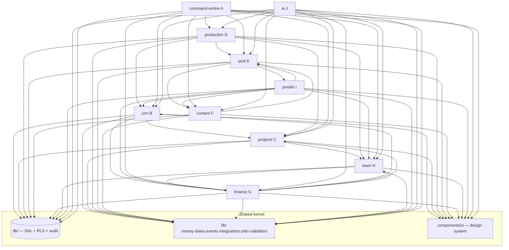

# Blanc Script OS — Module Architecture

**Status:** Planned (v0). Nothing in this document is implemented yet.
**Owner:** Backend & Database Architect (companion to `DATABASE_SCHEMA.md`).
**Scope:** The feature-module breakdown of the Next.js App Router application — folder structure, module boundaries matching the 10 product systems, the shared data-access layer, server-action/API conventions, and how modules depend on each other **without tight coupling**.
**Stack (locked):** Next.js App Router · React · TypeScript · Tailwind · shadcn/ui · Framer Motion (sparingly) · installable PWA · Vercel · Neon + Drizzle · Clerk + Neon Authorize RLS · Cloudflare R2 · Trigger.dev · Resend · Anthropic Claude. British English throughout.

> **Principle.** Each of the 10 product systems is a **feature module** that owns its UI, its server actions, and its domain logic — but **never its own DB access primitives**. All persistence goes through one **shared data-access layer (`db/`)** that enforces tenancy, RLS context and audit. Modules talk to each other through **typed service contracts and events**, not by importing each other's internals. The data model is single-owned (see `DATABASE_SCHEMA.md`); modules consume those table names, they do not redefine columns.

---

## 1. Top-level layout

The OS lives in its own App Router surface (planned at the repo's `app/(os)/` route group, isolated from the existing marketing site). Path alias `@/os/*`.

```
os/
├─ app/                         # Next.js App Router — thin routing + composition only
│  ├─ (auth)/                   # Clerk sign-in/up, org switch (unauthenticated shell)
│  ├─ (staff)/                  # Internal app shell (owner/ops/account_manager/editor/filmer)
│  │  ├─ layout.tsx             #   nav, command palette, auth guard (requireInternal)
│  │  ├─ today/                 #   System A — Command Centre
│  │  ├─ clients/               #   System B — CRM
│  │  ├─ projects/              #   System C — Projects & Tasks
│  │  ├─ production/            #   System D — Production Studio
│  │  ├─ post/                  #   System E — Post-production Studio
│  │  ├─ content/               #   System F — Content & Social Studio
│  │  ├─ finance/               #   System G — Finance & Commercials
│  │  ├─ team/                  #   System H — Team, Talent & Resources
│  │  └─ settings/              #   integrations, users, capabilities, branding
│  ├─ (portal-client)/          # System I — client portal shell (requireClient)
│  ├─ (portal-talent)/          # System I — talent portal shell (requireTalent)
│  ├─ api/                      # Route handlers: webhooks, R2 signing, AI stream, cron entry
│  │  ├─ webhooks/{clerk,xero,tiktok,meta,revolut,resend,frameio}/route.ts
│  │  ├─ ai/stream/route.ts     #   Claude streaming (Edge-safe, server-only key)
│  │  └─ media/sign/route.ts    #   R2 signed-URL minting (re-checks RLS)
│  └─ manifest.ts               # PWA manifest + shortcuts (Today, My shoots, Calendar)
│
├─ modules/                     # ← the 10 product systems live here (feature modules)
│  ├─ command-centre/           # A
│  ├─ crm/                      # B
│  ├─ projects/                 # C
│  ├─ production/               # D
│  ├─ post/                     # E
│  ├─ content/                  # F
│  ├─ finance/                  # G
│  ├─ team/                     # H
│  ├─ portals/                  # I  (client + talent surfaces & their data policies)
│  └─ ai/                       # J  Blanc Script AI (agentic, tool catalogue)
│
├─ db/                          # ← shared data-access layer (the ONLY place that touches Neon)
│  ├─ schema/                   #   Drizzle tables (owned per DATABASE_SCHEMA.md)
│  ├─ client.ts                 #   RLS-scoped connection factory (attaches Clerk JWT)
│  ├─ context.ts                #   getAuthContext(): { userId, orgId, role, caps, clientId, talentId }
│  ├─ repositories/             #   typed query functions per entity (no business logic)
│  └─ audit.ts                  #   writeActivity() — the audit entry point
│
├─ lib/                         # cross-cutting, non-domain
│  ├─ auth/                     #   Clerk helpers, requireInternal/requireClient/requireTalent, caps
│  ├─ money/                    #   pence maths, VAT (UK), formatting (Intl, en-GB)
│  ├─ dates/                    #   timestamptz ↔ Europe/London display
│  ├─ events/                   #   in-process domain event bus (typed)
│  ├─ integrations/             #   adapter interfaces + impls (xero, r2, resend, frameio…)
│  ├─ jobs/                     #   Trigger.dev task definitions (syncs, publishing, digests)
│  └─ validation/               #   shared Zod schemas (DTOs at the server-action boundary)
│
├─ components/                  # shared design-system UI (shadcn/ui wrappers, primitives)
│  └─ ui/                       #   Button, Table, Sheet, DataGrid, Money, StatusBadge…
│
└─ docs/                        # these planning docs
```

**Rule of thumb:** `app/` routes are *thin* — they resolve params, call a module's server action or repository, and render that module's components. No SQL, no business rules, no `fetch` to integrations live in `app/`.

---

## 2. Anatomy of a feature module

Every module under `modules/*` follows the **same internal shape**, so any engineer can navigate an unfamiliar module instantly:

```
modules/<system>/
├─ index.ts            # PUBLIC contract — the ONLY file other modules may import from
├─ actions/            # 'use server' server actions (the write + command surface)
├─ queries/            # read functions (compose db/repositories; shape view models)
├─ services/           # domain logic (pure-ish; orchestrates repos, emits events)
├─ components/         # module-owned React components (server + client)
├─ events.ts           # events this module EMITS and SUBSCRIBES to (typed)
├─ types.ts            # module DTOs / view models (not DB rows)
└─ permissions.ts      # capability checks this module enforces (thin, calls lib/auth)
```

- **`index.ts` is the module boundary.** Other modules import **only** `modules/<x>` (its barrel), never `modules/<x>/services/...`. This is enforced by an ESLint `no-restricted-imports`/boundaries rule. If it isn't exported from `index.ts`, it's private.
- **`services/`** holds the domain logic and is where cross-module calls originate — but a service calls another module's **public service contract** or emits an **event**; it never reaches into another module's repositories or components.
- **`queries/` vs `actions/`:** reads vs writes. Reads may run in Server Components directly; writes are server actions (`'use server'`) with validation + audit.

---

## 3. The 10 systems → modules (boundaries)

| # | System | Module | Owns (tables from `DATABASE_SCHEMA.md`) | Depends on (public contracts) |
|---|---|---|---|---|
| A | Command Centre | `command-centre` | *(none — read-only aggregator)* | crm, projects, production, post, content, finance, team, ai |
| B | CRM & Client Mgmt | `crm` | companies, contacts, clients, leads, client_notes, brand_assets, service_plans, client_services | projects (to open work), finance (quotes), portals |
| C | Projects & Tasks | `projects` | projects, project_templates, tasks, task_dependencies | crm (client ref), team (assignees) |
| D | Production Studio | `production` | shoots, shoot_briefs, shot_lists, shot_list_items, call_sheets, call_sheet_entries, locations, equipment, crew_assignments, castings | crm, projects, team (talent/crew), post (hands off footage) |
| E | Post-production Studio | `post` | media_assets, edits, edit_assignments, reviews, revisions, approvals, deliveries | production (source), content (hand-off), portals (client review), team (editors) |
| F | Content & Social Studio | `content` | content_items, content_calendar, social_posts, post_metrics | post (source edits), crm (client), integrations/jobs |
| G | Finance & Commercials | `finance` | quotes, proposals, invoices, invoice_lines, expenses, payments, retainers | crm, projects, team (pay-runs cross-ref) |
| H | Team, Talent & Resources | `team` | talent, talent_availability, pay_runs, talent_payments | production (castings), finance (pay affects money), crm |
| I | Portals (client + talent) | `portals` | *(no new tables — policy + view layer over others)* | crm, production, post, content, finance, team |
| J | Blanc Script AI | `ai` | ai_threads, ai_messages, ai_tool_invocations | **all** (via each module's tool contract) |

**Ownership = write authority.** Only the owning module writes its tables (through `db/repositories`). Other modules **read** via the owner's `queries` contract or shared repositories, and **request writes** via the owner's `actions`/`services`. Example: `finance` never inserts a `talent_payment`; it asks `team` (which owns pay-runs) and reads totals back.

---

## 4. Shared data-access layer (`db/`)

The single chokepoint for Neon. Three responsibilities: **RLS context, typed queries, audit.**

### 4.1 RLS-scoped connection
Every request resolves an auth context from Clerk and opens a connection whose JWT drives Postgres RLS (Neon Authorize). The app DB role is the non-superuser `authenticated` role; RLS does the isolation, the DAL does not re-implement tenancy in SQL `WHERE` clauses (defence in depth: it *also* passes `org_id`, but security does not depend on it).

```ts
// db/context.ts
export type AuthContext = {
  userId: string; orgId: string;
  role: OrgRole; caps: Record<string, boolean>;
  clientId: string | null; talentId: string | null;
};
export async function getAuthContext(): Promise<AuthContext> { /* Clerk auth() → memberships */ }

// db/client.ts — a connection bound to the caller's JWT so RLS sees the real user/role
export async function dbFor(ctx: AuthContext) { /* returns drizzle client w/ JWT set */ }
export async function withSystemDb<T>(fn, { orgId }): Promise<T> { /* service-role path for jobs/webhooks, still org-scoped */ }
```

- **Request path:** server action/component → `getAuthContext()` → `dbFor(ctx)` → repository call. RLS enforces role + portal isolation in the database.
- **Job/webhook path:** Trigger.dev tasks and webhooks have no Clerk user, so they use `withSystemDb` which sets an explicit `org_id` and a `actor_kind='system'` audit stamp; policies still apply via a system claim scoped to one org. Secrets never reach the client.

### 4.2 Repositories
`db/repositories/<entity>.ts` exposes typed, parameterised query functions — **no business rules**, no cross-entity policy. They default-filter `archived_at is null` and take the drizzle client as an argument (so they're RLS-agnostic and testable).

```ts
// db/repositories/clients.ts
export const clientsRepo = {
  byId:   (db, id) => db.select().from(clients).where(eq(clients.id, id)).limit(1),
  list:   (db, f) => db.select().from(clients).where(and(isNull(clients.archivedAt), /* filters */)),
  insert: (db, row) => db.insert(clients).values(row).returning(),
  update: (db, id, patch) => db.update(clients).set(patch).where(eq(clients.id, id)).returning(),
  archive:(db, id) => db.update(clients).set({ archivedAt: new Date() }).where(eq(clients.id, id)),
};
```

Modules compose repositories inside their `queries/`/`services/`; they do not write ad-hoc SQL in `app/`.

### 4.3 Audit
`db/audit.ts#writeActivity(ctx, {...})` is the single audit entry point, called by services on consequential writes. It inserts into `activity_log` (append-only) with actor, action, entity, and a `diff`. Money, pay, permission and AI-tool actions **must** audit.

---

## 5. Server actions & API conventions

### 5.1 Server actions (default write path)
Mutations are **server actions** (`'use server'`) living in `modules/<x>/actions/`. Every action follows one shape:

```ts
'use server';
export async function updateClient(input: unknown) {
  const ctx = await getAuthContext();                 // 1. auth
  const dto = UpdateClientSchema.parse(input);        // 2. validate (Zod)
  requireCap(ctx, 'can_edit');                        // 3. capability gate (app-level; RLS is the backstop)
  const db = await dbFor(ctx);                         // 4. RLS-scoped db
  const [row] = await crmService.updateClient(db, ctx, dto);  // 5. domain logic (+ emits event, + audit)
  revalidateTag(`client:${dto.id}`);                  // 6. cache invalidation
  return { ok: true, data: row };                     // 7. typed result (never throw raw to client)
}
```

Conventions:
- **Validation at the boundary:** every action parses input with a Zod schema from `lib/validation` or `modules/<x>/types`. Nothing trusts the client.
- **Capability check in the action, RLS in the DB:** app-level `requireCap` gives friendly UX/errors; RLS is the non-bypassable backstop. Both exist — neither alone.
- **Return typed results, not exceptions,** for expected failures (`{ ok:false, error }`); throw only for programmer errors.
- **Audit + events** happen inside the service, not the action, so background callers get them too.
- **Idempotency** for anything triggered by webhooks/jobs (natural keys / external_ref dedupe).

### 5.2 Route handlers (`app/api/*`) — only where actions can't reach
Reserved for: third-party **webhooks** (Clerk user/org sync, Xero, TikTok, Meta, Revolut, Resend, Frame.io), **R2 signed-URL** minting, **AI streaming** responses, and the **cron/job** entry points. These verify provider signatures, run under `withSystemDb`, and are the only place raw request/response is handled. No business UI calls them directly — UI uses server actions.

### 5.3 Background jobs (Trigger.dev)
`lib/jobs/*` defines scheduled + triggered tasks: Xero sync, social publishing (`social_posts` due), TikTok stats refresh, metrics snapshots (`post_metrics`), overdue-invoice digests, pay-run processing, recurring-playbook seeding from `project_templates`/`service_plans`. Jobs call module **services** (not repositories directly) so domain rules and audit run identically to interactive paths. Every integration call goes through an **adapter** (`lib/integrations/*`) so a provider outage degrades gracefully.

---

## 6. How modules depend on each other (without tight coupling)

Three sanctioned channels, in order of preference:

1. **Public service contracts (synchronous, directed).** Module X imports `modules/y` (barrel only) and calls an exported service/query. Used when X needs an authoritative read or a transactional write owned by Y. The dependency is **explicit, typed, and one-directional** per the table in §3. The dependency graph is a **DAG** — enforced by lint boundaries; cycles are a build error. (E.g. `production` depends on `post`, not vice-versa; `post` learns about new footage via an event, not a back-import.)

2. **Domain events (asynchronous, decoupled).** `lib/events` is a typed in-process bus. Modules emit facts (`ShootWrapped`, `EditSentToClient`, `InvoicePaid`, `PostPublished`) and others subscribe. This is how upstream notifies downstream **without depending on it**: `post` emits `EditSentToClient`; `command-centre`, `portals` (notifications) and `ai` react, while `post` knows nothing about them. Events carry IDs + minimal payload; subscribers re-read through contracts. Durable/cross-request reactions (emails, publishing) are handed to Trigger.dev.

3. **Shared kernel (`db/`, `lib/`, `components/ui`).** Everything common — the data-access layer, money/date/validation helpers, the design system — is depended on by all modules and depends on none of them. This is the stable core; it must stay domain-agnostic.

**Explicitly disallowed:** importing another module's `services/`/`repositories/`/`components/` directly; reaching into `db/schema` from `app/`; a module writing a table it doesn't own; circular module imports. Lint rules (`eslint-plugin-boundaries`) encode the §3 graph and fail CI on violation.

### 6.1 Command Centre & AI as pure consumers
- **`command-centre` (A)** owns no tables; it's a read-only aggregator composing other modules' `queries` + subscribing to events to build the "Today" feed and global command palette. It can depend on many modules precisely because it's a leaf that nothing depends on.
- **`ai` (J)** is also a consumer: each module publishes an **AI tool contract** (`modules/<x>/index.ts` exports `aiTools`) declaring its agentic tools with `{ mode: read|direct|popup|ask, requiredCapability, inputSchema, run }`. The `ai` module assembles the catalogue, runs Claude with the caller's context, and every tool execution flows back through that module's normal action (so capabilities, RLS, audit and confirmation apply). The AI never gets a privileged path — it acts strictly within the current user's role + capabilities, logging to `ai_tool_invocations`.

---

## 7. Portals as a policy/view layer (System I)

`portals` adds **no tables**. It provides the client- and talent-facing route groups and a thin presentation/guard layer that reuses other modules' `queries` under portal auth (`requireClient`/`requireTalent`). Isolation is **not** re-implemented here — it's guaranteed by RLS (`current_client_id()`/`current_talent_id()` from `DATABASE_SCHEMA.md` §3.3). The portal simply:
- mounts a restricted navigation,
- calls the same `crm`/`post`/`finance` queries (which return only the caller's rows because RLS says so),
- exposes the narrow write surfaces portals allow (client review/approve on `edits`; talent availability + profile on `talent`/`talent_availability`).

This keeps a single source of truth: there is no "portal copy" of client or edit logic to drift.

---

## 8. Cross-cutting conventions

- **Money & dates:** never format in modules; use `lib/money` (pence→`£` via `Intl`, en-GB) and `lib/dates` (store UTC, display Europe/London). A `<Money/>` and `<DateTime/>` component in `components/ui` are the only rendering path.
- **Caching:** Server Components + `revalidateTag`/`revalidatePath`. Tags are entity-scoped (`client:<id>`, `shoot:<id>`); actions invalidate what they touch. No client-side data store of record — the DB is the source of truth; React Query only for optimistic UI where needed.
- **PWA:** installable, with service worker and home-screen shortcuts. Offline is read-light (cached shell + last-seen lists); writes require connectivity (queued, not silently dropped).
- **Loading/empty/error states:** every route ships `loading.tsx`, an empty state, and `error.tsx`. No dead buttons, no fake data (foundation §37).
- **Implemented vs planned:** modules are built in milestone order (M1→M6, foundation §7). A module may exist as a stub exporting its contract before its UI lands; stubs return typed "not implemented" so dependents compile and the boundary is fixed early.
- **Testing seams:** repositories take `db` as an argument and services take `(db, ctx)` → unit-testable with a test db/branch; RLS is tested against a real Neon branch per role. (QA agent owns the strategy; this architecture provides the seams.)

---

## 9. Dependency diagram



Solid arrows are sanctioned **public-contract** dependencies (a DAG). Decoupled reactions additionally flow over the **event bus** (not drawn) so no upstream module imports a downstream one. The kernel (`db/`, `lib/`, `ui`) is depended on by all and depends on none.

*End of MODULE_ARCHITECTURE.md — all planned.*
