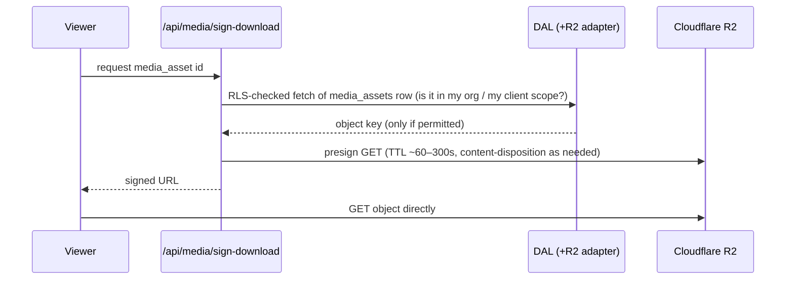
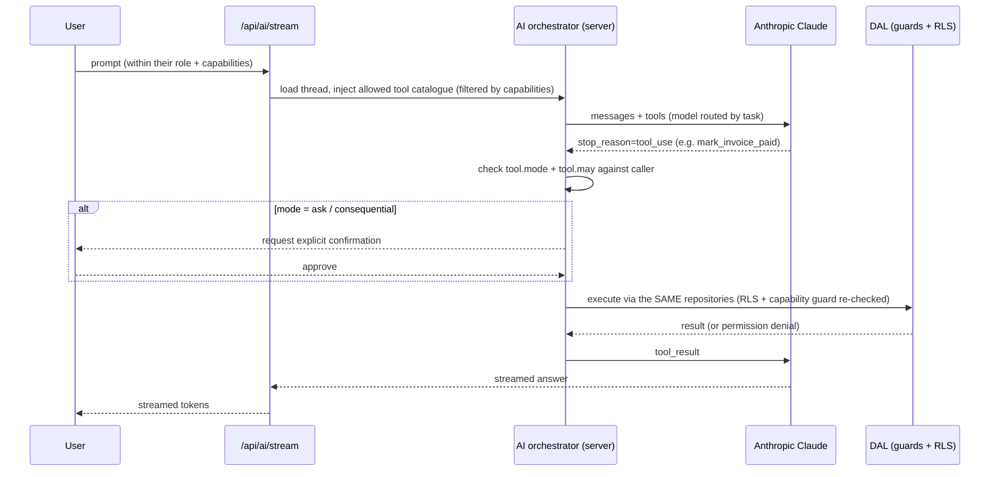

# Blanc Script OS — System Architecture

> **Status:** PLANNED (v0). Nothing in this document is implemented yet. It describes
> the intended architecture that downstream agents and the build will realise.
> **Source of truth:** `os/docs/_FOUNDATION.md` (the locked foundation). This document
> **consumes** the locked stack and the data-model spine; it does not invent either.
> Column-level schema is owned by the DB agent (`DATABASE_SCHEMA.md`); module internals
> by `MODULE_ARCHITECTURE.md`; roles/capabilities detail by the Security agent.
> **Audience:** every planning and build agent. British English throughout.
> **Context:** Blanc Script — a UK (Birmingham) creative video/photo production +
> social-media agency. We learn from Centauri OS and deliberately exceed it; we copy nothing.

---

## 1. Architecture at a glance

Blanc Script OS is a **single Next.js (App Router) application on Vercel** that presents
three strongly-separated surfaces — the internal **app shell** (staff), the **client
portal**, and the **talent portal** — over **one** shared Neon Postgres database. Isolation
is enforced in the database by **Row-Level Security (RLS)**, driven by **Clerk**-issued JWTs
that **Neon Authorize** validates on every connection. All third-party capability (media,
jobs, email, AI, realtime, video review, accounting, social, payments, messaging) sits
behind **adapter interfaces** so the app degrades gracefully when any provider is down.

```mermaid
flowchart TB
  subgraph Clients["Browsers / installed PWA"]
    S[Staff app shell]
    C[Client portal]
    T[Talent portal]
  end

  subgraph Edge["Vercel Edge"]
    MW["middleware.ts<br/>Clerk auth + host/route gating"]
  end

  subgraph Next["Next.js App Router (one app, one deploy)"]
    RSC["Server Components<br/>(read via DAL)"]
    SA["Server Actions / Route Handlers<br/>(guarded writes)"]
    CC["Client Components<br/>(interactivity, realtime sub, uploads)"]
    API["/api route handlers<br/>(webhooks, signed URLs, realtime token, SSE)"]
  end

  subgraph DAL["Data-Access Layer (server-only)"]
    REPO["Typed repositories +<br/>capability guards + audit"]
    AUTHCONN["Per-request authenticated<br/>Neon connection (Drizzle)"]
  end

  subgraph Core["Core services"]
    CLERK[(Clerk<br/>auth + orgs + roles)]
    NEON[(Neon Postgres<br/>Drizzle + RLS<br/>branch-per-preview)]
    R2[(Cloudflare R2<br/>media, signed URLs)]
    TRIG[(Trigger.dev<br/>jobs + schedules)]
    RESEND[(Resend<br/>email)]
    AI[(Anthropic Claude<br/>Haiku / Sonnet / Opus)]
    RT[(Realtime pub/sub<br/>adapter: Ably | SSE)]
  end

  subgraph Ext["Integration adapters (per-org, optional)"]
    FRAMEIO[Frame.io / Stream]
    XERO[Xero]
    SOCIAL[Social + Metricool/TikTok/Meta]
    PAY[Revolut pay-runs]
    MSG[WhatsApp / Periskope]
    GOOG[Google / Drive]
  end

  S & C & T --> MW --> Next
  RSC --> REPO
  SA --> REPO
  API --> REPO
  CC -- "fetch / action / subscribe" --> API & SA & RT
  REPO --> AUTHCONN --> NEON
  MW -. verifies .- CLERK
  AUTHCONN -. "Bearer JWT (Clerk)" .- CLERK
  SA & API --> R2 & RESEND & AI & RT
  TRIG --> REPO
  TRIG --> FRAMEIO & XERO & SOCIAL & PAY & MSG & GOOG
  SA --> TRIG
```

**Layering rule (strict):** UI → Server Actions/Route Handlers → **Data-Access Layer** →
Drizzle/Neon under RLS. The client **never** touches the database or holds a service key.
The DAL is the **only** place an authenticated DB connection is built — our principled
answer to Centauri's single `write_record` entry point (we keep the discipline of one
audited, guarded write path, without their single-table coupling).

---

## 2. Next.js App Router structure

One application, three route-group surfaces, plus auth and API. Route groups give each
surface its own layout, middleware gating, and navigation while sharing the DAL, design
system, and build. The three surfaces may optionally be presented on **subdomains**
(`app.`, `client.`, `talent.`) via host-based rewrites in `middleware.ts` — a Centauri-like
separation achieved from one codebase.

```
src/
  app/
    (auth)/                     # Clerk sign-in / sign-up / SSO callback
      sign-in/[[...rest]]/
      sign-up/[[...rest]]/
    (app)/                      # STAFF app shell — internal operating system
      layout.tsx                # staff-org guard, full nav, command palette
      command-centre/           # System A
      crm/                      # System B  (companies, contacts, clients, leads, notes)
      projects/                 # System C  (projects, tasks, dependencies, templates)
      production/               # System D  (shoots, briefs, shot lists, call sheets, crew)
      post/                     # System E  (media, edits, reviews, revisions, deliveries)
      content/                  # System F  (content items, calendar, social posts, metrics)
      finance/                  # System G  (quotes, proposals, invoices, expenses, pay)
      team/                     # System H  (members, talent book, availability, pay-runs)
      settings/                 # org, brand, integrations, users, capabilities, AI budget
    (client-portal)/            # System I — client_user ONLY
      layout.tsx                # portal guard: single client scope, minimal nav
      portal/                   # their shoots, deliveries/review+approve, chat, invoices
    (talent-portal)/            # System I — talent_user ONLY
      layout.tsx                # portal guard: single talent scope
      talent/                   # applications, availability, call sheets, payslips
    api/
      webhooks/clerk/           # user/org sync -> users/memberships
      webhooks/trigger/         # Trigger.dev callbacks
      webhooks/[provider]/      # Xero, social, Periskope, Frame.io, Revolut
      media/sign-upload/        # mint R2 presigned PUT / multipart
      media/sign-download/      # mint short-TTL presigned GET
      realtime/token/           # mint scoped realtime token (capability-checked)
      events/stream/            # SSE fallback channel
      ai/stream/                # streamed Claude responses
    manifest.webmanifest/       # PWA manifest route
  components/                   # cross-surface shared UI (thin)
  modules/                      # feature modules (see MODULE_ARCHITECTURE.md)
  design-system/                # @blancscript/ui — shadcn/ui + tokens + primitives
  db/                           # @blancscript/db — Drizzle schema + migrations (DB agent)
  data-access/                  # the DAL: repositories, guards, auth-connection factory
  lib/                          # adapters, auth helpers, ai, realtime, utils
  server/                       # server-only bootstrap, env validation (zod)
  middleware.ts                 # Clerk + host/route gating
```

**The 10 product systems** (foundation §5) map onto the staff route groups above
(A→command-centre … J→AI, which is cross-cutting: a right-rail assistant plus `ai/`
endpoints rather than a single page).

### 2.1 Server / client boundary

- **Server Components (default).** All first-render data fetching goes through the DAL.
  No secrets, keys, or DB handles ever cross into client bundles.
- **Server Actions** are the default mutation path: a form/interaction calls an action,
  the action runs **capability guards → DAL write → `activity_log` → `revalidateTag`**,
  and (where relevant) publishes a realtime/notification event and/or enqueues a
  Trigger.dev job. Actions are the "direct" write path.
- **Route Handlers** (`api/`) exist for things actions cannot do: third-party webhooks,
  streaming (SSE/AI), and minting signed URLs / realtime tokens.
- **Client Components** are used only where interactivity demands it: the command palette,
  drag-and-drop uploaders, realtime subscriptions, charts, kanban/drag, editors. They call
  Server Actions or `api/` endpoints — never the database.
- **Secrets are server-only.** `server/env.ts` validates and splits public (`NEXT_PUBLIC_*`)
  from private config at boot; private keys are never referenced from a client module.

---

## 3. Data-access layer (Drizzle + Neon + RLS)

### 3.1 Shape

```
data-access/
  connection.ts     # buildAuthedDb(token): per-request Drizzle client over Neon driver
  context.ts        # getRequestContext(): { userId, orgId, role, capabilities, portalScope }
  guards.ts         # assertCapability('can_invoice'), assertRole, assertPortalScope
  audit.ts          # writeActivity(): appends to activity_log inside the same txn
  repositories/     # one module per core entity group; typed query+mutation fns
    clients.ts  projects.ts  shoots.ts  media.ts  edits.ts  invoices.ts  talent.ts ...
```

Every repository function is **server-only**, takes the request context, runs through
**RLS at the database** (primary isolation) **and** an explicit **capability guard** in
code (defence in depth, and clearer errors than a bare RLS denial), and — for business
mutations — appends to `activity_log` within the same transaction. This single, typed,
audited path is how modules stay honest: there is no other way to reach the data.

### 3.2 The auth → RLS token flow (Clerk → Neon Authorize), concretely

RLS needs to know *who* is asking **inside Postgres**. We wire Clerk to Neon Authorize so
the database itself validates the caller on every connection — the app cannot "forget" to
scope a query.

**One-time configuration (planned):**

1. In Clerk, define a **JWT template** (or use the native session token) whose claims
   carry at least: `sub` (Clerk user id), `org_id` (active Blanc Script organisation),
   `org_role` (Clerk org role), and `portal_scope` (`staff` | `client:<id>` | `talent:<id>`
   for external users). Capabilities are **not** packed wholesale into the token (see §3.3).
2. In Neon, enable **Neon Authorize** and register Clerk's **JWKS URL / issuer** as the
   trusted provider. Neon creates a non-superuser **`authenticated`** Postgres role and
   exposes helpers (e.g. `auth.user_id()` reading `sub`, and `auth.jwt()` for other claims).
3. Grant the `authenticated` role only table/`USING`/`WITH CHECK` access that RLS permits;
   it is never a superuser and cannot bypass RLS.

**Per-request flow (every page load / action):**

```mermaid
sequenceDiagram
  participant B as Browser (PWA)
  participant MW as middleware (Clerk)
  participant SC as Server Component / Action
  participant DAL as Data-Access Layer
  participant PG as Neon Postgres (RLS)

  B->>MW: request (+ Clerk session cookie)
  MW-->>B: authenticated (or redirect to sign-in)
  SC->>SC: auth().getToken({ template: "neon" })  // Clerk-signed JWT
  SC->>DAL: repo.listClients()  (passes token + context)
  DAL->>PG: connect as role=authenticated,  Authorization: Bearer <JWT>
  PG->>PG: validate JWT vs Clerk JWKS; expose auth.user_id(), auth.jwt()
  PG->>PG: RLS USING ( org_id = auth.org_id() AND <role/capability checks> )
  PG-->>DAL: only rows this user may see
  DAL-->>SC: typed result
  SC-->>B: rendered HTML / action result
```

Because the JWT is validated **in the database connection**, a bug in application code
(a missing `where org_id = …`) still cannot leak another tenant's rows — RLS refuses them.
The Neon **serverless driver** (HTTP for one-shot queries, WebSocket for transactions) is
used so each serverless invocation opens a short-lived, correctly-scoped connection.

### 3.3 Where capabilities are enforced (an honest nuance)

Foundation §3 makes capabilities **individually overridable per user** (e.g. `can_see_money`,
`can_pay_team`, `can_approve_pay`). Two options exist:

- Put every capability flag in the JWT — simple reads, but **stale**: revoking a capability
  waits for the token to expire, and the token bloats.
- Keep **identity** in the JWT (`sub`, `org_id`, `org_role`, `portal_scope`) and read
  **live capabilities** from the `memberships` table.

**Decision (planned):** the JWT carries identity only. Coarse isolation and role live in
RLS from the token (`org_id = auth.org_id()`, portal scope). **Fine-grained, money-sensitive
capabilities** (`can_see_money`, `can_see_actor_pay`, `can_invoice`, `can_pay_team`,
`can_approve_pay`) are enforced by RLS policies that **join to `memberships`** for the
current `auth.user_id()` + `org_id`, so a revoked capability takes effect immediately; the
DAL's `guards.ts` repeats the check in code for clear errors and early exit. (The precise
policy SQL is the DB + Security agents' to finalise — flagged in §13.)

### 3.4 Privileged paths (no user context)

Trigger.dev jobs, Clerk webhooks, and migrations run **without** a user JWT. They use a
separate, server-only **service connection** (an owner/service Postgres role) that is used
**deliberately and narrowly** — never reachable from request handlers that serve a browser,
and every such job still writes to `activity_log` with a synthetic `system` actor.

---

## 4. File & media flow (Cloudflare R2)

R2 holds all media — raw footage, edits, images, brand assets, deliveries — in **private**
buckets (foundation: no public buckets for client media). The browser never receives R2
credentials; it receives **short-lived signed URLs** minted server-side after a capability
check. Large footage uses **multipart** upload so a shoot's clips resume on a flaky
connection.

**Upload (presigned PUT / multipart):**

```mermaid
sequenceDiagram
  participant U as Uploader (client component)
  participant API as /api/media/sign-upload
  participant DAL as DAL (+R2 adapter)
  participant R2 as Cloudflare R2
  participant TRIG as Trigger.dev

  U->>API: request upload (filename, size, mime, context: shoot/edit id)
  API->>DAL: assertCapability + create media_assets row (status=pending, org-scoped key)
  DAL->>R2: create multipart upload; presign each part (short TTL)
  API-->>U: media_asset id + presigned part URLs
  U->>R2: PUT parts directly (bypasses our server; no large bodies through Vercel)
  U->>API: complete (etags)
  API->>R2: complete multipart
  API->>DAL: media_assets.status = stored; writeActivity('media.uploaded')
  API->>TRIG: enqueue post-process (probe, thumbnail/poster, checksum, optional transcode)
  TRIG-->>DAL: update media_assets (duration, dimensions, poster key, checksum)
```

**Download / view (presigned GET):**



Keys are namespaced by org (`org/<org_id>/…`) so even a mis-issued signature cannot cross
tenants, and RLS on `media_assets` is the gate that decides whether a signature is minted
at all. **Gaps for the Lead:** image/video *transforms* (thumbnails, responsive sizes) —
do we use Cloudflare Images / a transform Worker, or do it in a Trigger.dev job? And the
Frame.io-vs-Cloudflare-Stream review path is still "evaluate" per foundation (see ADR-016).

---

## 5. Background jobs & schedules (Trigger.dev)

Trigger.dev runs everything that must happen **off the request path**, **durably**, or **on
a schedule** — beyond Vercel function time limits and with built-in retries, concurrency
control, and a run dashboard.

Planned job families (improving on Centauri's cron list):

- **Scheduled syncs:** accounting (Xero) hourly; social stats (TikTok/Meta/Metricool) daily;
  trending sounds every few hours. Each behind its integration adapter.
- **Scheduled publishing:** push due `social_posts` on a short cadence (e.g. every 5 min),
  idempotent per post.
- **Digests & reminders:** "Today" digests, overdue invoices, edit-due clocks, call-sheet
  reminders → via Resend and/or notifications.
- **Media post-processing:** probe/thumbnail/poster/checksum/transcode after R2 upload.
- **Pay-runs:** build actor/staff pay aggregates; execute via the Revolut adapter with a
  **sandbox vs live** toggle and explicit human approval gate (never auto-pays).
- **Fan-out:** heavy notification/realtime fan-out, AI batch jobs, webhook retries.
- **Clerk ⇄ DB reconciliation** and GDPR erasure execution (hard-delete path).

Jobs call back **through the DAL's service connection** (never direct SQL), so audit and
schema invariants hold. A triggered job that needs to tell users something publishes a
realtime/notification event exactly as a Server Action would.

---

## 6. AI service layer (Blanc Script AI — System J)

Server-only, **bring-your-own Anthropic key per org** (stored encrypted in `integrations`,
never shipped to the client), with **model routing**: Haiku for classification/routine,
Sonnet/Opus for reasoning (foundation §1). Persisted to `ai_threads` / `ai_messages`, with
usage/budget tracking.

The assistant is **agentic** (improving on Centauri's observed tool catalogue). Each tool
declares three things:

- an **execution mode** — `popup` (opens a pre-filled form to confirm), `direct` (saves
  immediately), or `ask` (requires explicit confirmation);
- a **capability guard** (`may:`), e.g. `mark_invoice_paid` guarded by `can_invoice`,
  `build_pay_run` by `can_pay_team`/`can_approve_pay`;
- a typed **Zod input schema**.



**Guardrail (non-negotiable, foundation §3):** the AI acts strictly **within the current
user's role + capabilities**, executes writes **through the same DAL and RLS** as a human
(it cannot exceed the person using it), and never performs a consequential action without
the right permission **and** confirmation. Long/bulk AI work runs as Trigger.dev jobs.

---

## 7. Realtime strategy

**Requirement.** Chat/messaging, notifications, presence, and live status (edit states,
shoot "on site", pay-run progress) should update without a refresh — a first-class part of
the product, as it was for Centauri.

**Constraint.** Neon is **serverless** Postgres and Vercel functions are short-lived.
`LISTEN/NOTIFY` needs a **persistently held** connection; Neon's pooled (transaction-mode)
endpoint does not support it, and a serverless function cannot economically hold an open
listener. So the obvious Postgres-native route is a poor fit here.

**Options considered:**

| Option | Fit for serverless/Neon | Verdict |
|---|---|---|
| Postgres `LISTEN/NOTIFY` | Needs a long-lived listener process; not viable from Vercel functions | **Rejected** (would require a separate always-on worker) |
| Polling / SSE from our own routes | Works, no new vendor; chatty at scale; SSE holds a function open | **Fallback / MVP** |
| Managed pub/sub (Ably or Pusher) | Purpose-built: token auth, presence, history, fan-out off our infra | **Chosen (primary)** |

**Decision (planned):** a **`RealtimeAdapter`** with two implementations behind one
interface (foundation §1: every integration behind an adapter):

1. **Primary — managed pub/sub (Ably proposed).** Writes still go **DB-first** through the
   DAL; **after** a successful, RLS-checked write, the Server Action/job **publishes** an
   event to an **org-scoped** (and, where needed, role/portal-scoped) channel. Clients
   subscribe using a **short-lived token** minted by `/api/realtime/token`, which runs the
   same capability check — so a client_user can only ever subscribe to their own client's
   channels. The database stays the source of truth; realtime is a notification layer, not
   a data layer.
2. **Fallback — SSE + short polling** via `/api/events/stream`, for MVP or if a provider is
   unavailable. Same event shapes, so modules don't care which is active.

**Flag for the Lead:** the locked stack (foundation §1) names no realtime provider. Adding
Ably/Pusher is a **new dependency** the Lead must approve; otherwise we ship **SSE/polling
only** for M1–M4 and revisit when chat (System H/portal) lands. See ADR-009.

---

## 8. Caching

Multi-tenant RLS data makes caching a **correctness** concern, not just performance.

- **Per-request memoisation:** wrap hot reads in React `cache()` to dedupe within a render.
- **Tenant data is dynamic by default:** never place user/tenant rows in Next.js's shared
  Data Cache without an org-scoped tag — cross-tenant leakage risk. Tenant reads are
  request-scoped; we `revalidateTag`/`revalidatePath` on mutation.
- **Tag discipline:** derived/expensive reads use `unstable_cache` **tagged by `org_id`**
  (and entity), invalidated precisely by the mutating Server Action.
- **Static/shared only on the CDN:** marketing/public assets and truly org-shared,
  non-sensitive config. Private media is served via **short-TTL signed URLs** and is **not**
  CDN-cached.
- **Optional edge KV (Upstash Redis / Vercel KV), behind an adapter:** rate limiting,
  idempotency keys (publishing, pay-runs, webhooks), realtime fan-out dedupe, lightweight
  counters. **Not in the locked stack** — Lead to approve or defer (ADR-014).

---

## 9. Environments

Vercel environments mapped to isolated backing services, with **Neon branching** as the
headline capability.

| Concern | Development | Preview (per PR) | Production |
|---|---|---|---|
| Hosting | local `next dev` | Vercel Preview | Vercel Production |
| Database | Neon dev branch (or local) | **Neon branch auto-created per preview** (Neon–Vercel integration) | Neon primary branch |
| Migrations | Drizzle Kit against dev branch | Drizzle Kit in CI against the preview branch | Drizzle Kit gated deploy step |
| Auth | Clerk dev instance | Clerk preview | Clerk production |
| Media | R2 dev bucket / prefix | R2 isolated prefix | R2 prod bucket |
| Jobs | Trigger.dev dev | Trigger.dev staging | Trigger.dev prod |
| Email | Resend test / sandbox | Resend sandbox | Resend prod (verified domain) |
| Secrets | `.env.local` (git-ignored) | Vercel env (Preview scope) | Vercel env (Production scope) |

Neon branch-per-preview means every PR gets a **real, isolated copy** of the schema (and
optionally seeded data) to test migrations and RLS safely before merge — something
Centauri's single Supabase project could not do per-PR.

---

## 10. Observability & error handling

- **Technical telemetry:** **Sentry** (errors, traces, optional session replay) across
  server and client; correlation ids threaded request → action → job. *(Sentry is not in
  the locked stack — approve as the observability vendor, ADR-018.)*
- **Platform insight:** Vercel Analytics/Speed Insights; Trigger.dev run dashboard; Neon
  metrics/slow queries; Clerk logs.
- **Client error capture:** an `/api/report-error`-style endpoint (Centauri had one) for
  graceful client-side failure reporting.
- **Business audit (distinct from logs):** `activity_log` records *who did what to which
  record* for every mutation — the user-visible, tamper-evident history, written in-txn by
  the DAL. `notifications` is the user-facing feed.
- **UX states (foundation §7):** every data view ships real loading, empty, and error
  states and React error boundaries; no dead buttons, no fake data.
- **Alerting:** Sentry + Trigger.dev failures route to the team (Slack/email) — thresholds
  owned by the QA/ops setup.

---

## 11. How modules stay decoupled

- **Feature modules** (`modules/<feature>`) each expose a **single public API** (an `index`
  barrel). Deep cross-module imports are forbidden and enforced by lint boundaries
  (`eslint-plugin-boundaries`).
- **Dependency direction is one-way:** `modules/*` → shared (`design-system`, `db`,
  `data-access`, `lib`) → never the reverse, and **no `module → module` imports**.
- **Modules communicate through contracts, not internals:** shared types + the DAL, plus
  **domain events** (`edit.sent_to_client`, `invoice.paid`) that fan out to notifications,
  realtime, and Trigger.dev — so, e.g., Finance need not import Post-production to react to
  a delivery.
- **Every external provider is an adapter** (`lib/adapters/*`) behind an interface: R2,
  Resend, Ably/SSE, Frame.io/Stream, Xero, Revolut, TikTok/Meta/Metricool, WhatsApp/
  Periskope, Google/Drive, Anthropic. A module depends on `MediaStorage`, not on R2; if a
  provider is down, the adapter fails gracefully and the app still runs (foundation §1).
- **Shared DB, not shared logic:** the three surfaces share the database and DAL; their
  *features* stay in their own modules.

---

## 12. PWA / offline posture

Blanc Script OS is an **installable PWA** (manifest, icons, home-screen shortcuts — e.g.
Today, My shoots, Calendar, Chat, mirroring Centauri's useful shortcuts), service worker via
Serwist/`next-pwa`, and **Web Push** for notifications and chat.

**Offline posture — deliberately narrow and honest.** This is an online-first operational
tool over **RLS-gated, multi-tenant, money-sensitive** data. Full offline replication is a
**non-goal**: we will not hold tenant databases, pay data, or stored client logins
unencrypted on devices. Instead we target the **on-set** reality where signal is poor:

- **App shell + recently-viewed reads** cached for fast, read-only continuity offline, with
  a clear "offline — showing last-known" banner.
- **Queue-and-retry for a small, safe set of field actions** (e.g. mark cast turned-up, add
  a quick task, log a battery-charge task) using background sync + **idempotency keys**, so
  they flush exactly once on reconnect.
- **Resumable media uploads** (R2 multipart) that survive connection drops on a shoot.
- **No offline writes** to money, pay, approvals, or permissions — these require live RLS.

This gives filmers genuine on-shoot usefulness without turning the device into an
unencrypted copy of the agency's books.

---

## 13. Open items this document surfaces for the Lead

See `ARCHITECTURE_DECISIONS.md` for the full reasoning. The concrete decisions still needing
the Lead/other agents:

1. **Realtime vendor** (Ably/Pusher) is **not** in the locked stack — approve it, or ship
   SSE/polling-only for early milestones (ADR-009).
2. **Capability-in-RLS vs capability-in-JWT** — this doc proposes membership-join policies
   for live money-sensitive flags; DB + Security agents to finalise the policy SQL (§3.3).
3. **External portal user modelling in Clerk** (flagged users vs separate orgs) — Security
   agent owns; affects RLS and token claims.
4. **Optional Upstash/Vercel KV** for rate-limit/idempotency, and **Sentry** for
   observability — both outside the locked stack; approve or defer (ADR-014, ADR-018).
5. **Media transforms** (Cloudflare Images / Worker vs Trigger.dev) and the **Frame.io vs
   Cloudflare Stream** review path (foundation says "evaluate") — ADR-016.
6. **Subdomain-per-surface vs single-domain route groups** — product/infra call; both are
   supported by the structure in §2.
```
